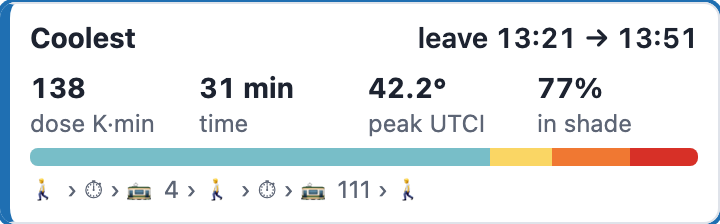
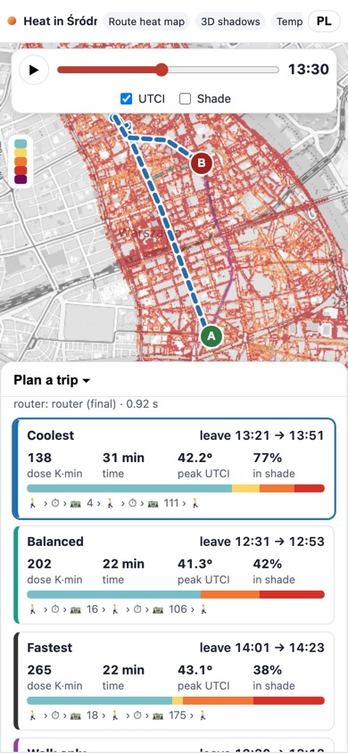
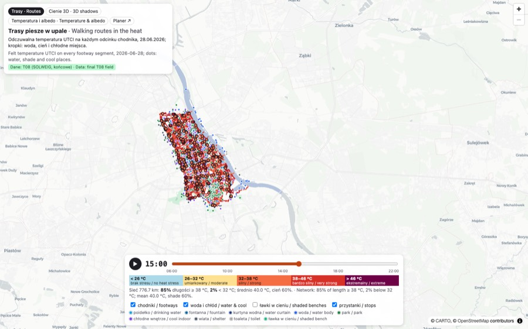

# Final verification (T07–T13, live services)

**Status (2026-10-18 03:55 UTC):** everything public renders, the planner answers all five T11 demo trips live on
the final field (`HEAT_SOURCE=final`, no notes), and every brief's *Done when* is met. I found nothing broken and
changed no code or service.

| URL | Desktop 1440×900 | Phone 390×844 |
|---|---|---|
| https://heat-app-269831067246.europe-central2.run.app | 200, 3.8 s; no console errors; slider 0/16/32 → 06:00/14:00/22:00; legend 26/32/38/46 | 200; no page-level horizontal overflow (scrollWidth 390); planner bottom sheet works |
| https://heat-views-269831067246.europe-central2.run.app/routes/ | 200; PL/EN captions; legend; badge "Dane: T08 (SOLWEIG, końcowe)" | 200; no overflow |
| …/shadows3d/ | 200 (WebGL via SwiftShader); sun dial, cloud, slider | 200 (12.6 s on headless WebGL) |
| …/temperature/ | 200; surface table and day curves; whole 27-tile frame | 200; no overflow |

I stepped the slider through all 33 steps on each page: app 558 requests, routes 34, 3D 55, temperature 172, with
0 HTTP errors and 0 page errors. All four pages show Polish and English text (app via `?lang=pl` / the PL/EN
button). Full-size screenshots are in `~/warsaw-open-data/screenshots/` (not committed). The scripts are here:
`pages.py`, `trips.py`, `steps.py`. Raw results are in `pages.json` and `live_trips.json`.

## Demo trips via the live app (UI: preset → *Plan*)

| Trip (window) | Coolest | Dose / time | Fastest | Dose / time | Walk only | Coolest vs fastest | vs walk | Round trip |
|---|---|---|---|---|---|---|---|---|
| Pl. Zbawiciela → Uniwersytet (12:30–14:30) | 13:21–13:51, tram 4 + bus 111 | 8,283 K·s / 30.6 min | 14:01–14:23 (18 + 175) | 15,916 K·s / 21.7 min | 55,983 K·s / 43.8 min | **−48 % for +8.9 min** | −85 % | 1.06 s |
| Dworzec Centralny → Łazienki (14:00–15:30) | 14:16–14:44, bus 520 | 13,696 / 27.3 | 14:39–15:03 (525) | 14,358 / 24.0 | 68,279 / 46.7 | −5 % for +3.3 min | −80 % | 0.87 s |
| Rondo Dmowskiego → Pl. Trzech Krzyży (18:30–20:00) | 19:42–19:51, bus 517 | 2,326 / 8.9 | same trip | 2,326 / 8.9 | 9,534 / 20.3 | 0 % | −76 % | 0.80 s |
| Centrum Nauki Kopernik → Hala Mirowska (15:00–16:30) | 15:36–16:13, bus 118 + 106 | 16,725 / 37.1 | 16:00–16:27 (106) | 24,818 / 27.2 | 75,869 / 45.9 | −33 % for +9.9 min | −78 % | 1.02 s |
| Plac Zamkowy → Pl. Zbawiciela (08:00–18:00) | 08:08–08:30, tram 4 | 1,294 / 21.5 | 10:17–10:34 (13 + 16) | 9,874 / 17.6 | 16,506 / 58.6 | **−87 % for +3.9 min** | −92 % | 5.22 s |

These match `reports/INTEGRATION` and `reports/T10` to the K·s. The phone and desktop UI gave identical answers.
`POST /api/price` with a 2-point line from Zbawiciela to Uniwersytet at 13:00 returns 43.8 min and 57,118 K·s,
the same as the walk-only plan, so the integration fix for `price_path` is live.

 

## Done when, per brief

| Brief | Done when | Met | Evidence |
|---|---|---|---|
| T07 | UTCI + Tmrt for every walkable pixel, 33 steps, in `T07/` | yes | `utci.tif`, `tmrt.tif` (33 bands), `_SUCCESS` 02:46Z. Coverage 99.96 %; 909 px outside the tiles, all outside the AOI |
| T07 | Report covers the checks and gaps | yes | `reports/T07/README.md` |
| T08 | Every outdoor component-0 segment and every stop has a value for all 33 steps | yes | BigQuery: 1,937,595 rows = 58,715 × 33, 11,880 = 360 × 33, 0 NULL, steps 0–32 |
| T08 | Tables in BigQuery and the bucket | yes | `warsaw_heat.t08_*`, `T08/*.parquet`, `_SUCCESS` 03:10Z |
| T08 | Report shows the shady and sunny sides of known streets | yes | Marszałkowska / Al. Ujazdowskie table in `reports/T08` |
| T09 | Answers the T03 test pairs at several departure times | yes | `reports/T09/final/examples.csv` (4 pairs × 8 windows); `t09-router` health is `final` |
| T09 | Coolest clearly below fastest on at least one pair, with the time cost | yes | −48 % for +8.9 min live (T09 report: −30 % for +6.9 min in its 13:00–14:00 window) |
| T10 | Public time-slider map of the whole district and live plans for the demo trips | yes | Table above; 33 steps, frames `t07_utci` / `t07_shade` |
| T11 | Demo trips fixed, each with a comparison table | yes | `demo/demo_trips.json`, `reports/T11/comparison_final.csv` (5 trips, 55 rows) |
| T11 | Headline numbers in the report | yes | `reports/T11/headline_final.md` |
| T12 | T13 builds all three views from `T12/` without further processing | yes | `T12/_SUCCESS`, manifest; route values come from T08 (out of T12's scope) |
| T13 | Three public pages showing the whole district for all 33 steps | yes | See the table at the top; zoomed out, the temperature frame covers all 27 tiles (checked on `utci/18.png`) |

## Observations (no action taken)

- **App on the phone:** the header title is cut to "Heat in Śródr…" and the view chips scroll sideways inside the
  header (the page itself does not overflow). The legend starts collapsed to colour swatches and expands on tap.
  This is by design, but on a phone you see no numbers until you tap it.
- **Dmowskiego → Trzech Krzyży:** coolest, balanced and fastest are the same trip (bus 517), so this demo shows only
  the transit vs walking contrast.
- **Dworzec → Łazienki:** coolest is only 5 % below fastest. The tree effect shows in T11's walk comparisons, not
  in the transit options.
- `minutes_per_category` counts ride minutes in the AC vehicle as "<26", which is why coolest trips have a large
  blue bar.
- The 10-hour window takes 5.2 s (`runtime_s` 5.15); every other query takes about 1 s.
- Known gaps from the task reports still stand (user decisions): the T07 far shadows at 20:00–20:30, the T01 DTM
  step at E 638000, no evening pavement heat release, the T08 special-case conventions, and the T12 city water-point
  API, which needs a token.
