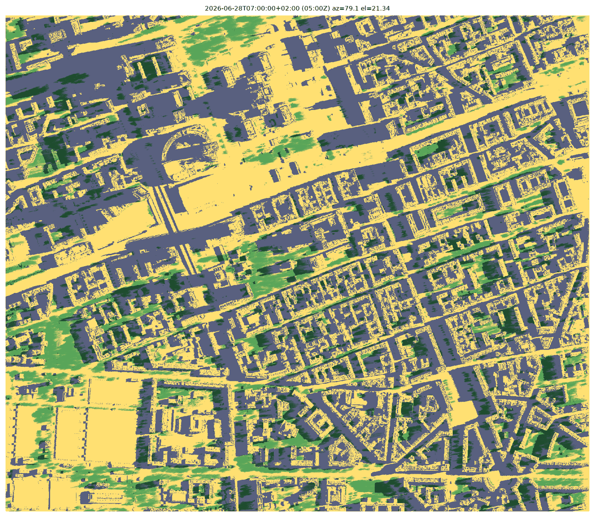
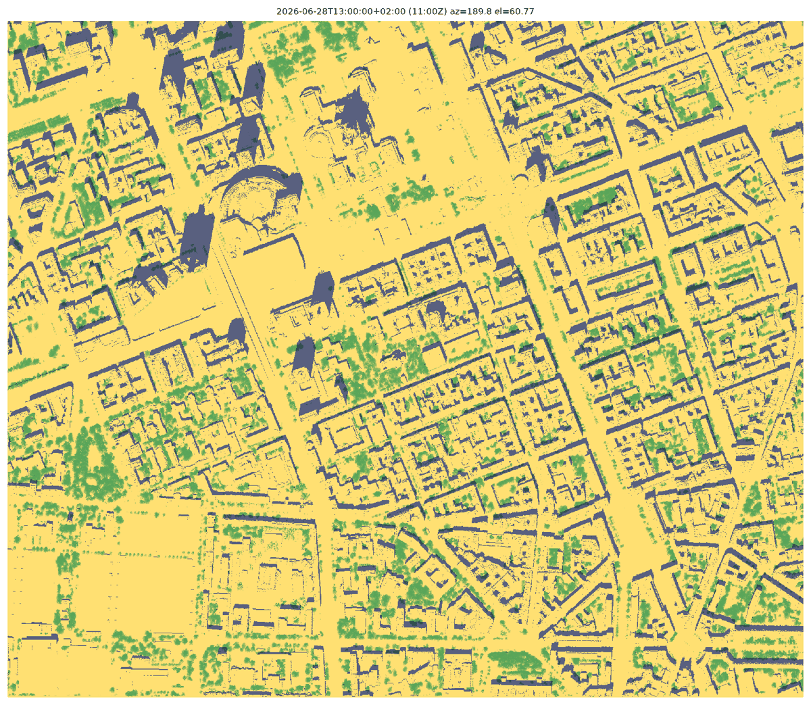
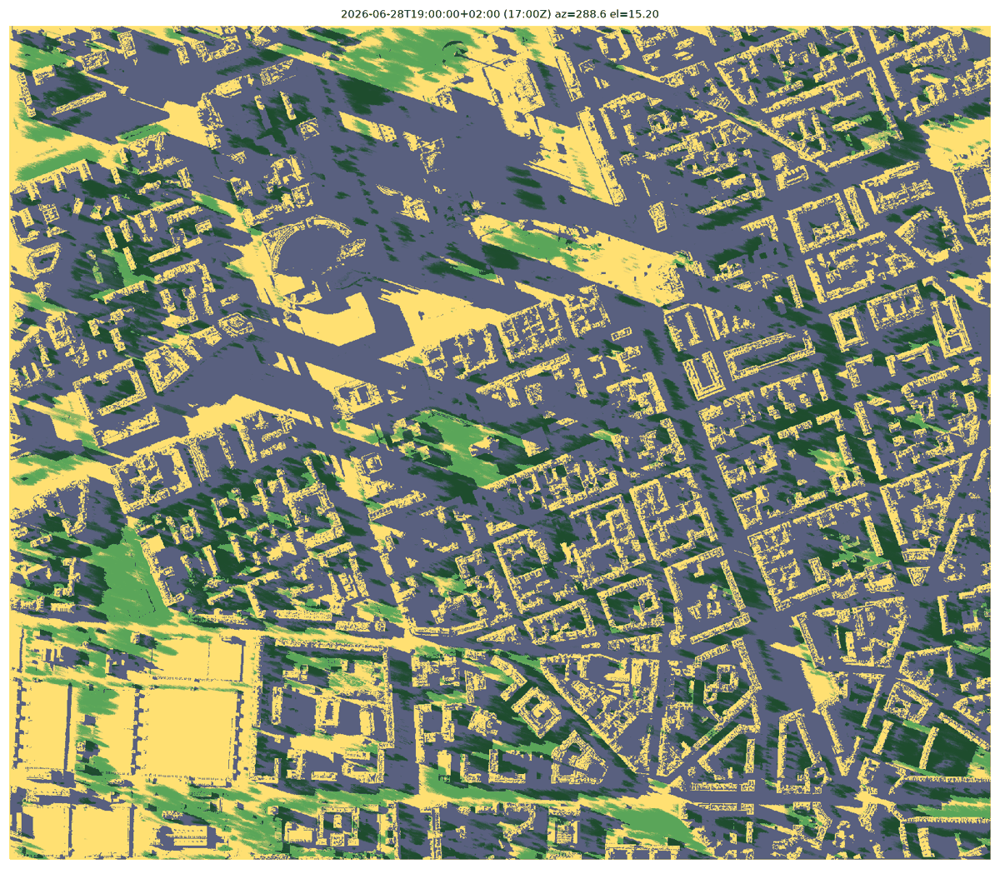
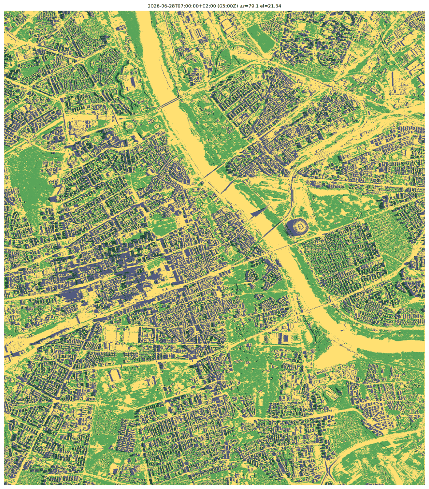
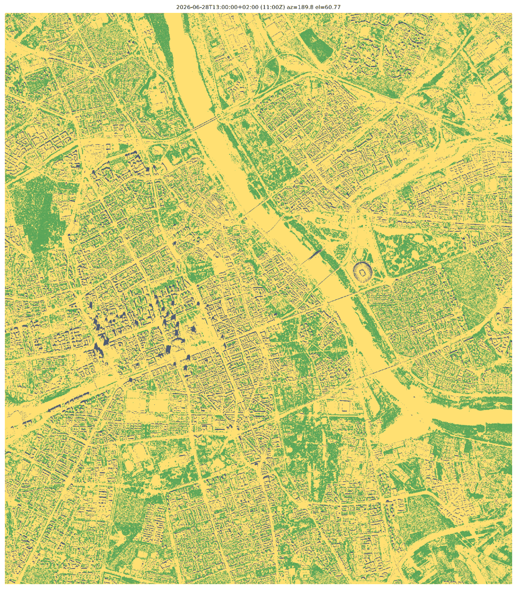
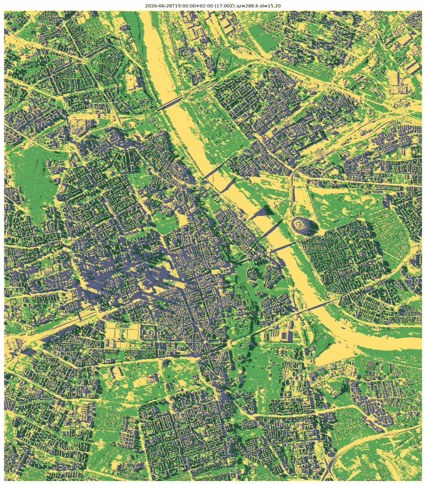

# T02 report: shade engine

Status 2026-10-18: **engine built and validated; production run done on T01's layers** (`gs://hackaton-honory-heat/T02/`).

## What was produced

- **Engine:** [`shade/`](../../shade/README.md) (pure Python + numba). Interface, method and how crown transmission enters the shares are documented in the module README.
  - `engine.py`: building/terrain shade, tree transmission, shares, sky view factor.
  - `sun.py`: the 33 time steps and sun positions.
  - `run.py`: production runner, writing COG outputs, timings and previews.
- **Tests:** `shade/tests/` covers synthetic box, tower, cylinder tree, a far caster outside the grid, canyon SVF and sun positions; all 19 pass.
- **Validation on real data:** a 2.0 × 1.7 km dev area around PKiN/Varso/Chmielna. It uses 12 LiDAR sheets from the 2023-09-05 flight, turned into crude 1 m layers by `shade/dev_geometry.py`, a stand-in for T01.
- **Previews** of the dev area. Yellow = sun, slate = buildings, light green = trees, dark green = both:

  | 07:00 | 13:00 | 19:00 |
  |---|---|---|
  |  |  |  |

  Mean shares over the dev area (sun / bldg / tree / both): 07:00 0.41 / 0.42 / 0.08 / 0.08; 13:00 0.74 / 0.16 / 0.09 / 0.01; 19:00 0.28 / 0.53 / 0.06 / 0.13.

## Production run

- **Inputs:**
  - T01's layers from `gs://hackaton-honory-heat/T01/output/`; T01's `crown_gap_fraction` is used as vertical crown transmission.
  - A far-caster surface, built here because T01 had finished before the caster extent was added: `far_casters/dsm_far.tif`, 13 × 11 km, 305 sheets of the 2025 flight (28 GB, 210 of them reused from T01's bucket). Same rule as T01's `dsm`.
- **Far-caster surface:** data on 92 % of the cells outside the grid (the rest is mostly Vistula water with no returns). The tallest objects outside the grid are real:
  - a 199 m chimney at 52.2947 N 20.9933 E (most likely the Żerań CHP plant), north of the district, so it never shades it;
  - ~100 m towers in western Wola and Gocław.
- **Outputs** in `gs://hackaton-honory-heat/T02/`, each described in `README.md` there:
  - `f_sun.tif`, `f_bldg.tif`, `f_tree.tif`, `f_both.tif`: 33 bands each.
  - `svf.tif`.
  - `far_casters/dsm_far.tif`.
- **Shares sum check:** the four sum to 1 in 100 % of pixels at full resolution. Overviews are per-band averages, so there they are only within ±1/250.
- **Mean shares over the whole grid** (sun / bldg / tree / both). The grid includes Łazienki, Pole Mokotowskie and the Vistula banks:

  | Time | sun | bldg | tree | both |
  |---|---|---|---|---|
  | 07:00 | 0.43 | 0.21 | 0.28 | 0.08 |
  | 13:00 | 0.68 | 0.07 | 0.25 | 0.01 |
  | 19:00 | 0.32 | 0.26 | 0.28 | 0.15 |
  | 20:30 | 0.05 | 0.19 | 0.13 | 0.63 |

- **Runtime** on c2d-highmem-8, 8.1 GB peak (`timings_production.json`). The real canopy is larger than in the benchmark, so this was about 2.5× slower:
  - **33 steps:** 9.5 min including writes (7.3 min of compute, 4.9–77 s per sunlit step).
  - **SVF:** 65 min.
  - **Whole run:** 77 min.
- **SVF values:** buildings + terrain median 0.91 (p1 0.29). With crowns median 0.59.

  | 07:00 | 13:00 | 19:00 |
  |---|---|---|
  |  |  |  |

## Checks

**Synthetic scenes:** shadow lengths and directions are analytic to within 1–2 cells.
- Box (8 sun positions incl. diagonals): length = exit distance + h / tan e within 2 cells; centroid bearing = anti-sun azimuth within 2°.
- 100 m tower at 3°, 5° and 12.5° sun: shadows of 1.9 km, 1.1 km and 0.45 km, within 3 cells. The shadow is a 1–2 cell line with no stray pixels.
- Cylinder crown (base 4 m, top 12 m, τ = 0.05) at 60°, 30° and 10°: the optical path matches the analytic chord through the crown within 1.5 m. At 10° the sun passes **under** the crown at the trunk.
- Infinite canyon H/W = 1: SVF 0.447 vs analytic cos(atan 2) = 0.447.

**Real tower (PKiN spire alone, 226.6 m above ground in the dev DSM, 3–5 m ground drop along the ray):**

| Local time | Sun elev. | Engine tip | Analytic tip | Bearing (engine / anti-sun) |
|---|---|---|---|---|
| 07:00 | 21.3° | 588 m | 589 m | 259.1° / 259.1° |
| 13:00 | 60.8° | 126 m | 127 m | 9.6° / 9.8° |
| 17:00 | 33.3° | 350 m | 351 m | 85.7° (both) |
| 18:00 | 24.1° | 514 m | 516 m | 97.3° / 97.4° |
| 19:00 | 15.2° | 854 m | 856 m | 108.6° (both) |

The task brief says PKiN's shadow is "about 530 m at 18:00": 514 m from the spire matches, given that this shadow is cast from a 237 m height at 24°.

**Orthophoto (2023-09-05, 5 cm RGB, sheet N-34-139-A-c-1-1, same GI-FOTO.6201.22.2023 job as the LiDAR):**
- The photo time is unknown, so for each 240–280 m window the engine was run every 3 min over 08:00–11:00 UTC and the time with the best agreement against dark ground pixels (Otsu) was kept.
- All five windows chose **09:33–09:51 UTC**, which matches the LiDAR strips flown over the area at 09:02–10:07 UTC (from GPS time in the LAZ files). Only one parameter is fitted, and it lands where it should.

| Window | Fitted UTC | Precision (engine shade is dark in photo) | Recall | IoU |
|---|---|---|---|---|
| pkin_plaza | 09:36 | 0.87 | 0.66 | 0.60 |
| varso_north | 09:33 | 0.89 | 0.78 | 0.71 |
| chmielna | 09:51 | 0.89 | 0.88 | 0.79 |
| nowy_swiat | 09:39 | 0.86 | 0.74 | 0.66 |
| swietokrzyska | 09:51 | 0.87 | 0.38 | 0.36 |

- **Precision is 0.86–0.89 everywhere.** The red edges in `ortho_*.png` are 1 m outlines of shadows, partly because the true orthophoto and the 1 m grid don't align exactly.
- **Recall is lower where dark surfaces are not shadow:** asphalt, tram tracks, cars and a construction site (Świętokrzyska). The validation can't separate these from shadow.
- Not done yet: an on-site check of low-sun shadows on a sunny evening.

## Runtime and memory

Measured on c2d-highmem-8 (8 vCPU, AMD Milan) in `hackaton-honory`, europe-central2-a, at the true production size:
- **Shared grid:** E 634,000–642,000, N 483,000–492,000, i.e. 8000 × 9000 = **72 Mpx**. The brief's "~37 Mpx" was low.
- **Caster surface:** the full [caster extent](../../tasks/README.md), 13000 × 11000 = **143 Mpx**.
- Both were filled by tiling the dev area.

| | Per step | All 33 steps |
|---|---|---|
| Shade compute (buildings with far casters + trees) | 2.3 s (13:00) – 34 s (20:30, 3.1°) | **180 s** |
| Incl. writing 4 GeoTIFF bands | 3.8 s – 41 s | 298 s |
| SVF (256 sky directions, with crowns, grid only) | – | 1510 s (25 min) |
| Peak RSS | 7.0 GB | 8.4 GB |
| **Total incl. COG conversion** | | **32 min** |

- **Low sun is the slow case** for the tree march, because rays climb slowly above the crowns. The building sweep is O(pixels) per step whatever the shadow length, so the 143 Mpx caster surface adds little.
- **Scaling:** a 0.5 m grid would be about 4× the pixels and roughly 6–8× the time, a few hours on the same VM.
- **Dev area (3.4 Mpx):** 0.2–1.5 s per step, SVF 96 s.

## What I learned about the data

- **LAZ class 12 (overlap) holds about 72 % of points** (23 of 32 M in sheet …-1-1-3-3). The remaining ~27 pts/m² are plenty. T01 should not treat 12 as noise blindly; those are valid points flagged as overlap.
- **Class 0 and class 9 occur too** (0.4 M unclassified and 1.8 k class 9 in one sheet), although GUGiK says water is 8.
- **The flight takes hours:** strips run 09:02–10:07 UTC plus one at 14:43 UTC on 2023-09-05. Orthophoto shadows are from mid-morning (≈ 43° sun, azimuth 160°).
- **Tallest objects in the dev area:** Varso spire at 310.2 m above ground, which agrees with T01's spot-check value. PKiN reads 226.6 m: the 1 m max of class-6 points misses the thin spire tip (237 m).
- **Crude `dev_geometry` caveats:** crown base is the lowest class-5 point, so it catches lower branches. Transmission is the first-return ground fraction in 5 × 5 m (median 0.20), a LiDAR gap fraction, not shortwave τ (literature: 3–10 %). T01's real layers replace both.

## Open issues

1. **Crown transmission source:** T01's `crown_gap_fraction` is a LiDAR gap fraction (median 0.016 in Ogród Saski, 0.16 on Aleje Ujazdowskie), not shortwave transmissivity. It is used as τ as is. If T06 finds another mapping, only the shares need re-running (~11 min).
2. **Light through crowns may be counted twice:** the shares carry measured crown transmission (the τ fraction counts as sun), and the thermal model's tree-zone factor may represent the same light again. Now recorded in spec §13 (points to settle), to be decided when tuning against SOLWEIG (T06).
3. **Receiver height:** shares are for the surface (0 m). For UTCI at body height, rerun with `--receiver-height 1.1`. The change is small except right next to walls.
4. **Terrain self-shade counts as `f_bldg`:** curbs and walls in the DTM shade 1–2 % of cells at low sun. T01's DTM smoothing decides how much remains.
5. **Shadow length is not capped:** at 20:30 (3.1°) a 310 m tower casts ≈5.7 km, far beyond the 1 km halo.
   - The spec and shared conventions now define a caster extent of 13 × 11 km: the AOI shifted towards the sun by 310 m / tan(elevation) for every sunlit step.
   - The engine sweeps it with `--far-dsm`, and T01 delivers a ground + buildings surface over it.
   - The sun is treated as a point. With the real 0.53° disc a 40 m wide tower keeps a full shadow for ~4 km, so these lengths are physical; only thin spires are slightly overstated far away (see `shade/README.md`).
6. **On-site check of evening shadows:** not done.

## Where things are

- **Code:** `shade/` in this repo.
- **Figures:** this folder: `preview_*.png`, `ortho_*.png`, `ortho_validation.json`, `timings_dev_3.4Mpx.json`, `timings_full_72Mpx.json`, `timings_production.json`, `prod_preview_*.png`.
- **VM `t02-shade`** (c2d-highmem-8, europe-central2-a, 100 GB disk, stopped after this work):
  - `~/laz/`: 12 LiDAR sheets
  - `~/ortho/`: orthophoto sheet
  - `~/dev_in/`, `~/dev_out/`: dev layers and outputs
  - `~/bench72_in/`, `~/bench72_far.tif`: full-size benchmark inputs (tiled dev area)
  - `~/laz_far/`: 305 far-caster LAZ sheets of the 2025 flight
  - `~/t01/`, `~/far/`, `~/prod_out/`: production inputs and outputs (copies of the bucket files)
