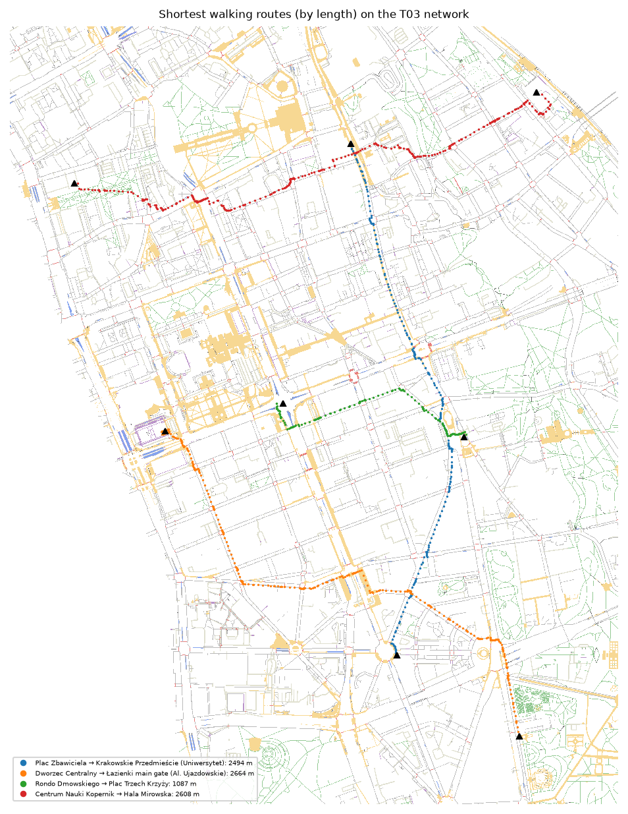
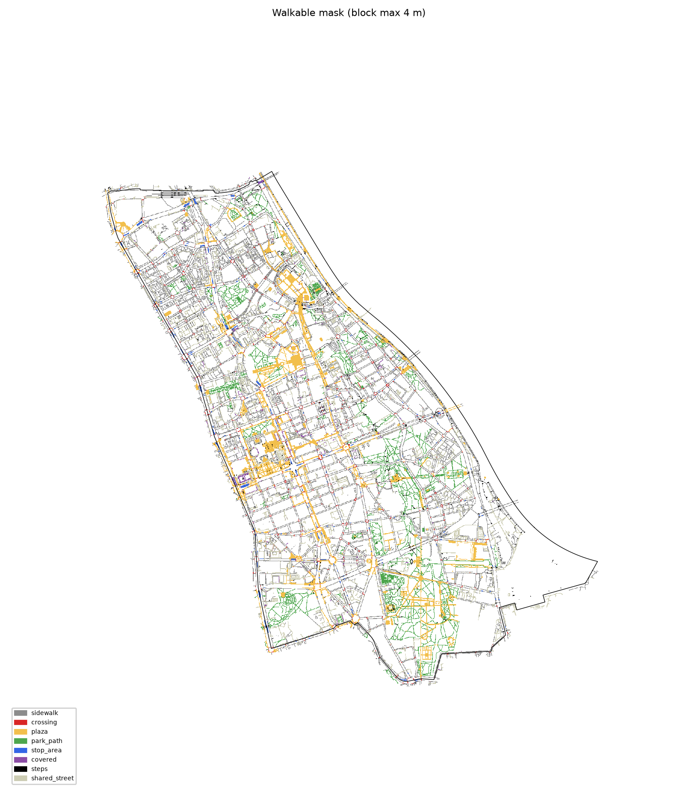
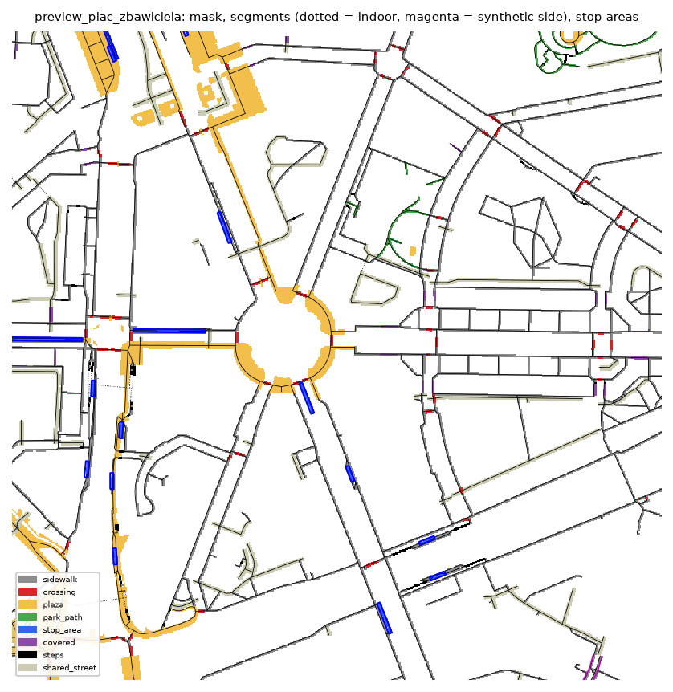
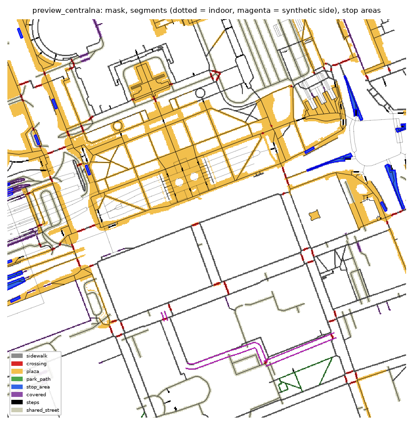

# T03 report: walkable space, walk network and stop waiting areas

## What was produced and where

All outputs are in `gs://hackaton-honory-heat/T03/`. The same tables are in BigQuery as `hackaton-honory.warsaw_heat.t03_*`, with geometries as WGS84 GEOGRAPHY. Schemas, sources and nodata conventions are in [`walk/README.md`](../../walk/README.md), also uploaded as `T03/README.md`.

| Output | File | Size |
|---|---|---|
| Walkable mask with 8 categories, shared 1 m grid | `walkable.tif` | 2.23 M walkable pixels |
| Walk network: segments (≤ 25 m) and nodes | `network/segments.parquet`, `network/nodes.parquet` | 58,715 segments, 49,191 nodes |
| Segment → pixel lookup | `network/segment_pixels.parquet` | 2.06 M rows |
| Stop waiting areas, one per GTFS `stop_id` | `stops/stop_areas.parquet` | 360 stops (324 strictly inside the AOI) |
| Test routes, stats, previews | `checks/` | |

**Rerun:** run these on a cloud VM (T03 used an e2-highmem-4); each takes about 80 s:
- `walk/fetch.sh IN 2026-10-16`
- `python -m walk.run IN OUT`
- `python -m walk.routes OUT`
- `python -m walk.to_bq OUT` (BigQuery load)

Two runs on the same inputs gave identical segments, pixel tables and mask, byte for byte.

## Coverage (inside the AOI)

| Kind | km |
|---|---|
| sidewalk (`footway=sidewalk`) | 235.6 |
| other footway | 296.8 |
| shared street: service roads 98.4, living streets 10.4 | 108.8 |
| pedestrian street (edges) | 28.0 |
| path | 16.6 |
| tram/bus platform | 15.5 |
| crossing: 1,931 ways, of which 486 signalised | 12.6 |
| steps | 12.4 |
| synthetic street side | 10.3 |
| connector (mapping gaps ≤ 5 m) | 2.6 |
| indoor corridor | 1.3 |

Flags: **15.2 km indoor/underground** (mostly the underground passages around Centralna and Rondo Dmowskiego), and **9.4 km covered** (arcades, building passages, covered platforms).

Mask pixels:

| Category | Pixels |
|---|---|
| sidewalk | 867 k |
| plaza | 618 k |
| shared street | 428 k |
| park path | 200 k |
| crossing | 43 k |
| stop area | 33 k |
| covered | 22 k |
| steps | 21 k |

**Connectivity:** the main component holds **99.0 %** of network length. The other 150 components total 7.4 km, of which 4.8 km are inside the AOI. They are mostly courtyard service roads and park or riverside paths with no mapped link, the largest being 830 m. They keep a `component` ≠ 0, and the router should use component 0 only.

## How the side of the street is represented

Śródmieście's OSM is mapped in detail. On almost all primary, secondary, tertiary and residential streets the sidewalks are separate ways (`sidewalk=separate` or `no`). On those streets the router walks the real sidewalk geometry, so it already knows which side of the street it is on. Where the carriageway itself is tagged with sidewalks there are two cases:

- **Unmapped sidewalks.** A residential, tertiary or similar street with `sidewalk=yes/both/left/right`, or untagged, gets **one synthetic edge per side that has a sidewalk** (`kind=street_side`, `side=l|r`). Each is a 2 m band, offset from the centreline by half the carriageway width plus 1 m. The carriageway width comes from `width`, then `lanes × 3 m`, then a per-class default. Both side edges share the centreline's nodes, every ≤ 25 m, so the router can cross mid-block. That is realistic on these narrow, quiet streets. This applies to **10.3 km on 44 streets**, almost all narrow Old Town, New Town and Powiśle streets (Długa 1.3 km, Kozia, Świętej Barbary, Dynasy, Sapieżyńska, Ciasna, Nowiniarska) plus Bonifraterska.
- **Shared space.** Service roads (driveways, parking aisles, courtyards) and living streets are walked on their centreline, with the carriageway as footprint (4 m by default, 5 m for parking aisles).
- **No sidewalk.** Streets with `sidewalk=no` on both sides, trunks without a sidewalk tag, and road tunnels are not walkable along their length; they can still be crossed at mapped crossings.

BDOT10k was not needed: OSM covers the district, and the few gaps are handled by the synthetic sides and connectors above.

## Stops

- **360 GTFS tram/bus stop_ids** have a waiting area: 272 bus, 84 tram, 4 bus+tram.
- **Matching to OSM:** 356 by OSM `ref` (which equals the GTFS `stop_id`, e.g. `704401`), 2 spatially, and 2 unmatched: `700272` Dw. Centralny and `707551` Legia – Stadion. The unmatched two get a rectangle at the GTFS point.
- **Shelter:** 279 yes, 79 no, 2 unknown. Inside the AOI only: 260 / 62 / 2.
- **Geometry:**
  - 54 OSM platform polygons (tram islands), median 308 m².
  - 3 buffered platform lines.
  - 303 rectangles (3 m × 15 m bus, 3 m × 30 m tram) centred on the OSM platform node, or on the GTFS point for the unmatched two, and aligned with the nearest sidewalk.
- **Access:** every area has an `access_node_id` on the main network; 95 % are within 11 m and the farthest is 21 m (a Rondo Radosława median platform).
- **Why 360, not the brief's 330:** the PRG boundary runs along the axes of Al. Jana Pawła II and Al. Niepodległości and through Rondo Radosława. Median tram platforms there sit 0.5–3 m outside the polygon, and far-kerb stops up to about 23 m outside. A strict `within` test gives 324 (249 bus, 71 tram, 4 bus+tram). Stops within 25 m are included and flagged with `in_aoi`.

## Routability check

Shortest paths by length on component 0 (`walk/routes.py`):

| From → to | Length | Straight line | Detour | Crossings (signalised) | Steps | Indoor |
|---|---|---|---|---|---|---|
| Plac Zbawiciela → Krakowskie Przedmieście (Uniwersytet stop) | 2,494 m | 2,269 m | 1.10 | 15 (6) | 0 | 0 m |
| Dworzec Centralny → Łazienki main gate (Al. Ujazdowskie) | 2,664 m | 2,069 m | 1.29 | 22 (8) | 2 | 75 m |
| Rondo Dmowskiego → Plac Trzech Krzyży | 1,087 m | 815 m | 1.33 | 9 (6) | 1 | 59 m |
| Centrum Nauki Kopernik → Hala Mirowska | 2,608 m | 2,084 m | 1.25 | 12 (5) | 1 | 0 m |

## Previews

Whole district, categories (4 m block maximum):

Plac Zbawiciela: sidewalks, crossings (red), pedestrian areas, stop areas (blue) and synthetic sides (magenta):

Centralna and Rondo Dmowskiego: underground passages are dotted and not in the mask:

## What was learned about the data

- **Plazas:** `place=square` polygons (Plac Zbawiciela, Plac Konstytucji) include the carriageway, so only `highway=pedestrian|footway` areas and `area:highway` polygons count as plaza.
- **Platforms:** metro and rail platforms are mapped as `public_transport=platform` too. They are excluded, because metro and rail are out of scope.
- **Indoor tagging is mixed:** `tunnel=yes`, `indoor=*`, `highway=corridor`, `location=underground` and negative `level` together with `tunnel`. All of them map to the `indoor` flag. `tunnel=building_passage` and `covered=*` map to `covered`, which stays outdoor in the mask.
- **Mapping gaps:** 477 dead ends of minor components lay within 5 m of the main network and were closed with `connector` segments, which joined 261 components.
- **Footprints over buildings:** 274 segments, mostly sidewalks drawn along façades, had a footprint that held no pixel once buildings were cut out. They got the pixels under their own line instead.

## Open issues

- **Plaza interiors:** edges run only along mapped ways and pedestrian-area outlines; there are no diagonal shortcuts across open plazas such as Plac Defilad. The plaza pixels are in the mask but are not linked to any segment.
- **Indoor pixels:** indoor segments have no pixels. T07/T08 need a rule for them, e.g. a constant indoor UTCI.
- **Waiting-area geometry:** stop rectangles are a fixed size; real shelter positions are not mapped.
- **Mask beyond the AOI:** the mask extends up to about 50 m outside the AOI along kept segments, so that boundary segments get full pixels.
