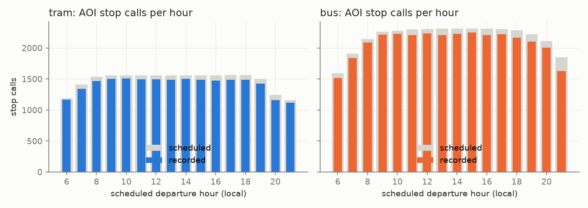
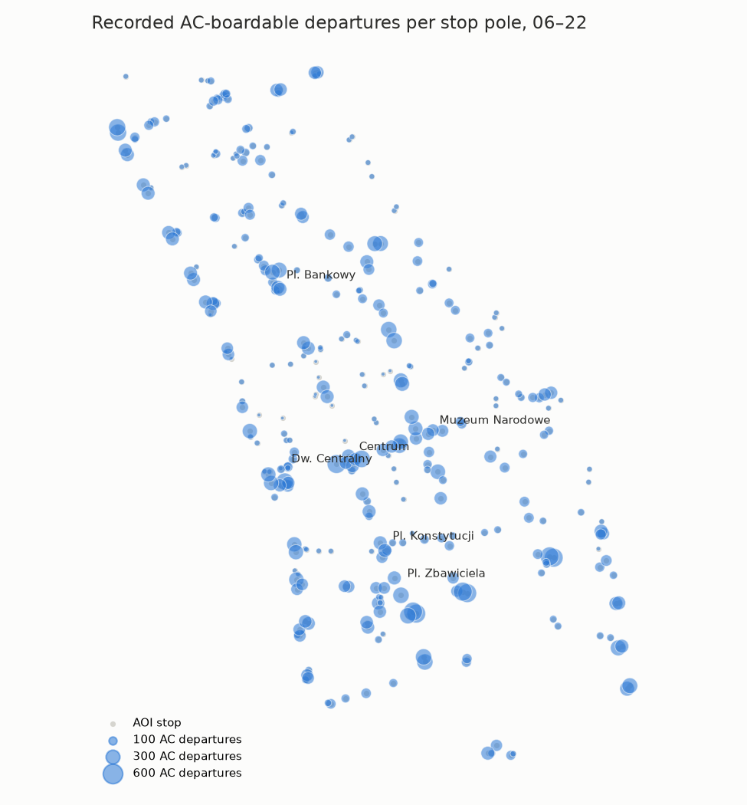
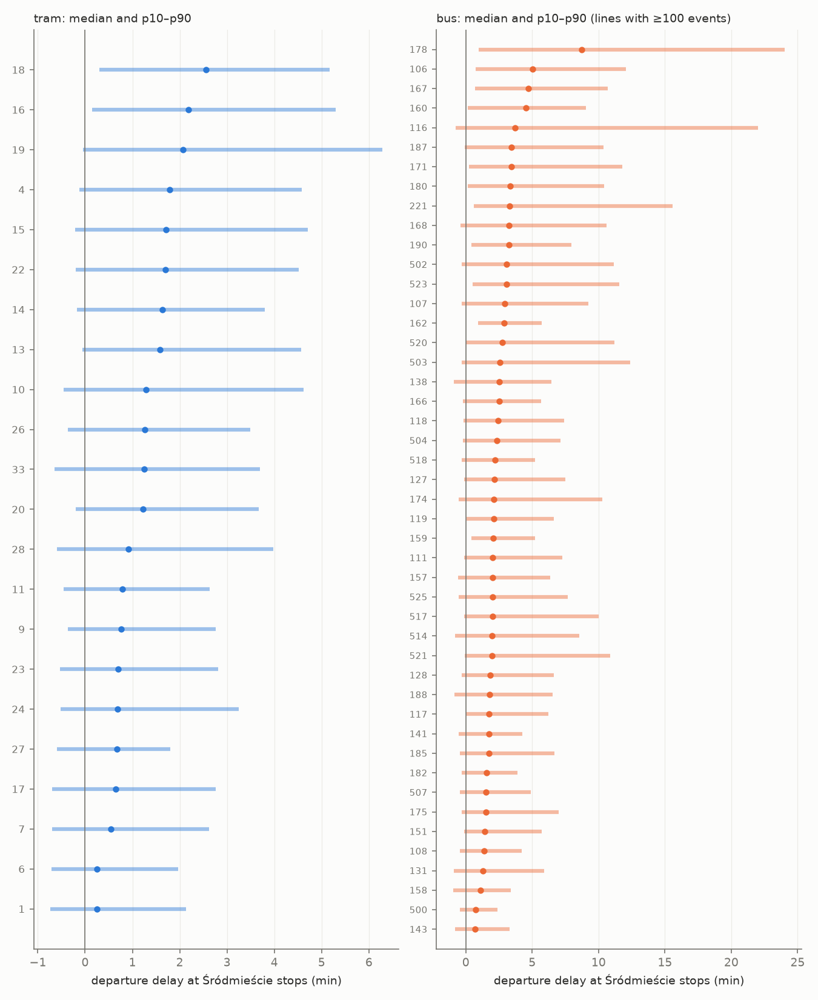

# T04 report: recorded tram and bus stop events with AC

Service day **2026-10-17** (Saturday), window **06:00–22:00 local**, Śródmieście (TERYT 146510_8, stops within 30 m of the boundary included). Generated by `python -m transit.report`; method in [`transit/README.md`](../../transit/README.md).

## What was produced

| Output | Where | Rows |
|---|---|---|
| Stop events | BigQuery `hackaton-honory.warsaw_heat.stop_events` (partition `service_date`), `gs://hackaton-honory-heat/T04/2026-10-17/stop_events.parquet` | 56,625 |
| Runs | `hackaton-honory.warsaw_heat.runs`, `gs://hackaton-honory-heat/T04/2026-10-17/runs.parquet` | 7,555 |
| Per-line timetable deviation | [`line_delays.csv`](line_delays.csv) | 69 |
| Code | `transit/` (`stop_events.py`, `report.py`, `sql/`) | |

Router use (T09): board only rows with `ac_boardable = TRUE`; `departure` is the recorded time the vehicle left the stop pole, `arrival` the recorded time it got there. Join `stop_id` to T03's stop waiting areas.

## Coverage against the scheduled Saturday service

Scheduled = GTFS (mkuran.pl feed of 2026-10-16) tram/bus trips with at least one Śródmieście stop departure in the window. Recorded = a stop event exists for that trip and stop.

| mode | scheduled_trips | operated_trips | trips_share | scheduled_stop_calls | recorded_stop_calls | calls_share | calls share on operated trips | runs |
|---|---|---|---|---|---|---|---|---|
| tram | 3181 | 3042 | 95.6% | 23660 | 22608 | 95.6% | 99.7% | 3045 |
| bus | 4624 | 4505 | 97.4% | 34811 | 33356 | 95.8% | 97.6% | 4510 |



Share of scheduled stop calls recorded, by hour (the 21:00 dip is the feed outage listed under Known gaps):

| hour | bus % | tram % |
|---|---|---|
| 6 | 95.2 | 98.5 |
| 7 | 96.4 | 94.9 |
| 8 | 97.4 | 95.4 |
| 9 | 97.7 | 96.3 |
| 10 | 97.9 | 96.7 |
| 11 | 96.1 | 96.0 |
| 12 | 96.9 | 95.6 |
| 13 | 95.7 | 95.6 |
| 14 | 96.5 | 96.4 |
| 15 | 97.3 | 95.3 |
| 16 | 95.7 | 94.3 |
| 17 | 96.3 | 94.8 |
| 18 | 94.8 | 95.0 |
| 19 | 94.7 | 95.2 |
| 20 | 94.8 | 93.0 |
| 21 | 88.2 | 96.0 |

Recorded departures at main stops (all poles, both modes) per local hour — every hour 06–21 is covered (Muzeum Narodowe is the stop at rondo de Gaulle'a):

| stop | 06 | 07 | 08 | 09 | 10 | 11 | 12 | 13 | 14 | 15 | 16 | 17 | 18 | 19 | 20 | 21 |
|---|---|---|---|---|---|---|---|---|---|---|---|---|---|---|---|---|
| Centrum | 115 | 130 | 150 | 150 | 156 | 147 | 150 | 152 | 154 | 153 | 148 | 160 | 145 | 149 | 129 | 120 |
| Pl. Zbawiciela | 35 | 43 | 46 | 46 | 47 | 46 | 46 | 46 | 47 | 48 | 46 | 44 | 49 | 41 | 39 | 35 |
| Muzeum Narodowe | 50 | 65 | 71 | 70 | 72 | 66 | 71 | 70 | 71 | 72 | 71 | 71 | 68 | 67 | 64 | 58 |
| Dw. Centralny | 141 | 172 | 187 | 193 | 194 | 188 | 193 | 199 | 190 | 194 | 189 | 195 | 176 | 196 | 168 | 146 |
| Pl. Bankowy | 40 | 46 | 57 | 58 | 62 | 59 | 59 | 57 | 60 | 58 | 61 | 62 | 57 | 54 | 48 | 43 |
| Pl. Konstytucji | 52 | 61 | 68 | 76 | 72 | 71 | 72 | 69 | 77 | 70 | 72 | 72 | 76 | 71 | 62 | 53 |

## Air conditioning

AC comes from the fleet register (`ztm_vehicles` → `ztm_vehicle_models.air_conditioning`, snapshot closest to the service day) of the vehicle that actually drove the run, joined on `(mode, vehicle_number)`. Unknown AC → `ac_boardable = FALSE`.

| mode | AC | no AC | unknown | AC share |
|---|---|---|---|---|
| bus | 4470 | 0 | 40 | 99.1 |
| tram | 2936 | 96 | 13 | 96.4 |

Share of recorded departures that are AC-boardable: tram 97.3%, bus 99.0%.

Lines with fewer than 95% AC runs:

| mode | line | runs | AC runs % |
|---|---|---|---|
| tram | 7 | 105 | 35 |
| tram | 28 | 99 | 72 |
| bus | 166 | 93 | 76 |
| bus | 106 | 122 | 85 |
| tram | 4 | 124 | 90 |

Vehicle types behind the non-AC runs:

| mode | brand | model_type | runs | vehicles |
|---|---|---|---|---|
| tram | Alstom Konstal | 116N | 84 | 6 |
| tram | Konstal | 116N | 12 | 1 |

Runs with unknown AC (treated as not boardable):

| mode | why | runs | vehicles |
|---|---|---|---|
| bus | not in register | 40 | 3 |
| tram | model without AC info | 13 | 1 |



## Deviation from the timetable

Delay = recorded departure − scheduled departure, at Śródmieście stops. Negative = early.

| mode | events | 5% | 10% | 50% | 90% | 95% |
|---|---|---|---|---|---|---|
| bus | 33650 | -47 | -16 | 141 | 534 | 752 |
| tram | 22975 | -43 | -23 | 76 | 258 | 326 |

Departures more than 60 s early: tram 0.4%, bus 3.0%. Because the router uses recorded departures, the timetable deviation matters only as a guide for the walk-timing safety margin: per-line p05/p10 (early side) and p90/p95 (late side) are in [`line_delays.csv`](line_delays.csv).



## Matching quality

- Position reports used: 1,406,691 fresh (report age ≤ 120 s), de-duplicated across the two APIs and repeated polls, within 1500 m of the district. Vehicles report about every 10 s.
- 1,249,872 reports belong to a (line, brigade) block that serves Śródmieście; 1,224,542 (98.0%) of them were assigned to a trip of that block.
- Event time source: tram 97.9% observed / 2.1% interpolated; bus 94.5% / 5.5%. Interpolation gap median 20 s, p90 93 s (max allowed 300 s).
- Dwell (departure − arrival): median 20 s, p90 60 s. Long dwells are layovers at terminal stops inside the district.
- Runs with < 80% of their Śródmieście stops matched: 264 of 7,555 (3.5%).
- Time-monotonicity violations in the output: 0 (arrival ≥ previous departure and departure ≥ arrival are enforced).
- Trips claimed by two vehicles (best kept): 0.

## Known gaps

- **Trips not operated / not recorded:** 258 scheduled trips have no run. The one checked by hand is a real gap (tram 10 brigade 8: its vehicle stops reporting near the district after 10:47); the others were not checked one by one. Lines with most missing trips:

| mode | line | not operated | scheduled |
|---|---|---|---|
| tram | 28 | 25 | 124 |
| bus | 504 | 19 | 89 |
| tram | 7 | 16 | 121 |
| tram | 20 | 15 | 123 |
| bus | 523 | 15 | 182 |
| bus | 517 | 14 | 130 |
| tram | 16 | 14 | 251 |
| tram | 19 | 13 | 125 |
| bus | 187 | 13 | 93 |
| tram | 6 | 12 | 122 |
| tram | 17 | 11 | 249 |
| bus | 174 | 10 | 95 |
| tram | 1 | 10 | 248 |
| bus | 151 | 8 | 94 |
| tram | 13 | 8 | 98 |

- **Operations outside the timetable blocks** are not in the output: reports on lines that serve the district under a brigade whose Saturday GTFS block has no Śródmieście trip (extra or replacement brigades, blank brigade, or blocks that only run near the district):

| mode | line | brigade | n_reports |
|---|---|---|---|
| bus | 116 | (blank) | 510 |
| bus | 503 | (blank) | 441 |
| bus | 131 | 265 | 351 |
| bus | 131 | 264 | 345 |
| bus | 178 | M8 | 315 |
| bus | 178 | M7 | 279 |
| bus | 178 | M6 | 276 |
| bus | 517 | 237 | 221 |
| bus | 141 | 205 | 197 |
| bus | 517 | 239 | 188 |
| bus | 175 | 280 | 186 |
| bus | 175 | 283 | 174 |

- **Feed outages** (fresh reports below 60% of the usual rate for ≥ 3 min; the collector kept polling, the city API served stale positions). Stops passed during them are interpolated if the gap is ≤ 300 s, otherwise missing:
  - 21:53–22:07 local, 33% of the usual report rate

- **Runs more than 60 min late** (or more than 30 min early) cannot be matched to their trip.
- **Arrival vs departure resolution** is limited by the 10 s report interval: a single report at a stop gives arrival = departure. Interpolated stops always have arrival = departure.
- **Shapes passing the same point twice** (terminal loops) project reports to the nearest pass; the monotonic filter drops the inconsistent ones.
- **Metro and rail are out of scope**; stops are GTFS poles (`stop_id`), not stop groups.
- **Vehicle register gaps:** see the unknown-AC table above.

## Reproduce

```bash
pip install -r transit/requirements.txt
python -m transit.stop_events --date 2026-10-17 --start 06:00 --end 22:00 --out t04_out/2026-10-17
python -m transit.report t04_out/2026-10-17
```

Runtime 30 s on a laptop (BigQuery does the heavy filtering). Parameters: `STOP_BUFFER_M=30`, `PING_BUFFER_M=1500`, `MAX_REPORT_AGE_S=120`, `SHAPE_STEP_M=5`, `MAX_SHAPE_DIST_M=60`, `TRIP_PRE_S=1800`, `TRIP_POST_S=3600`, `NULL_COST=3.0`, `SWITCH_COST=1.0`, `SKIP_COST=0.5`, `HEADING_COST=4.0`, `MIN_MOVE_M=15`, `FROZEN_SPREAD_M=50`, `STOP_RADIUS_M=30`, `MAX_SHAPE_OFFSET_OBS_M=40`, `MAX_GAP_S=300`, `BACKTRACK_M=40`.
