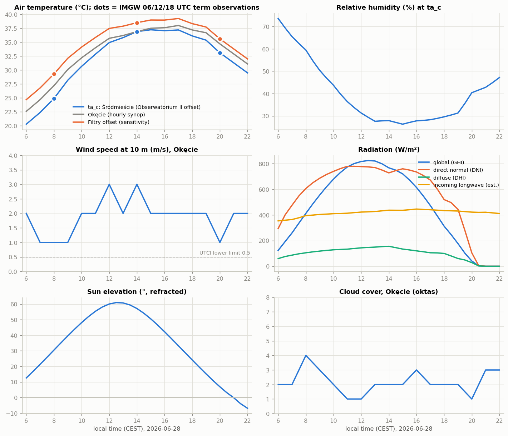
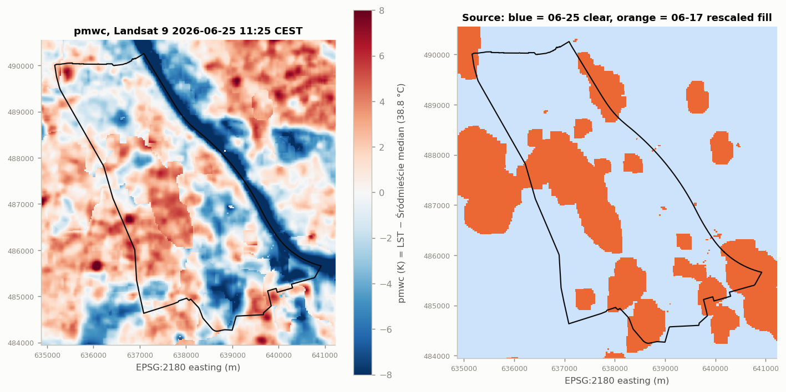

# T05 report: weather forcing for 2026-06-28 and Landsat surface-heat anomaly (`pmwc`)

**Status:** done, 2026-10-18.

## What was produced

| Output | Where |
|---|---|
| Forcing, 33 steps 06:00–22:00 CEST (04:00Z–20:00Z), no gaps | `gs://hackaton-honory-heat/T05/forcing/forcing_20260628.{parquet,csv}`, BigQuery `hackaton-honory.warsaw_heat.t05_forcing_20260628` |
| Station offsets, daily Tmax/Tmin, sunshine, ERA5 comparison | `T05/forcing/checks.json` |
| `pmwc_10m.tif`: surface-temperature anomaly, K, district median = 0 | `T05/pmwc/` with `pmwc_source_10m.tif`, `pmwc_20260625_masked_10m.tif`, `lst_20260625_masked_10m.tif`, `meta.json`, `scene_screen.json` |
| HTML report | `T05/report/report.html` |

Column definitions and per-file caveats are in the READMEs next to the outputs. Code: [`meteo/`](../../meteo/README.md).

## Forcing

| Column | Source |
|---|---|
| `ta_c` | IMGW hourly synop Warszawa-Okęcie + offset to the climate station **Warszawa-Obserwatorium II** (Al. Ujazdowskie, Śródmieście): −2.3 / 0.0 / −1.6 K at 06/12/18 UTC, linear in between, held constant outside |
| `ta_okecie_c`, `ta_filtry_adj_c` | Okęcie unadjusted; Okęcie + Filtry offset (+2.1 / +1.6 / +0.9 K) for a built-up sensitivity run |
| `rh_pct`, `vp_hpa` | Okęcie vapour pressure, RH recomputed at `ta_c` |
| `wind_10m_ms`, `wind_10m_utci_ms` | Okęcie 10 m; UTCI input = max(0.5, wind). No canyon reduction |
| `ghi_wm2`, `dni_wm2`, `dhi_wm2` | ERA5 (Open-Meteo), interpolated via clear-sky index; GHI = DHI + DNI·sin(elev) to < 0.2 W/m² |
| `sun_elev_deg`, `sun_azim_deg` | pvlib SPA, same convention as `shade/sun.py` |

- **Peak:** `ta_c` 37.2 °C (station Tmax 37.7 °C), Okęcie 38.0 °C, Filtry-adjusted 39.2 °C. The 04Z value of 20.3 °C matches Tmin 20.1 °C.
- **Air-term uncertainty:** `ta_c` and `ta_filtry_adj_c` differ by 1.6–4.4 K, least at midday.
- **Sky:** clear all day (Okęcie sunshine fraction ≈ 1.0). Sun sets between 20:30 and 21:00, so the last three steps are night.

## `pmwc`

- Landsat Collection-2 L2 surface temperature minus the Śródmieście median (311.99 K = 38.8 °C). 10 m grid, extent of the shared 1 m grid; each 10 m cell is exactly 10 × 10 grid cells.
- Scene **LC09 2026-06-25 09:25 UTC** (11:25 CEST), three days before the heat day. 32 % of the district was cloud-masked and filled from the clear **LC08 2026-06-17** anomaly, rescaled with a fit on pixels clear in both (slope 0.966, r = 0.94, residual SD 1.2 K).
- District percentiles: 5 % −7.3 K, 25 % −2.3 K, 75 % +2.2 K, 95 % +4.4 K. The Vistula (~2 % of the district) is strongly negative.

## What we learned about the data

- **No public hourly series inside Śródmieście exists for June 2026.** The IMGW 10-min telemetry archive is gone from danepubliczne; city ZOM and air-quality sensors are live-only. Obserwatorium II has 3 observations a day plus Tmax/Tmin, which is enough for an offset on Okęcie.
- **Obserwatorium II sits in a park,** so `ta_c` is a cool-side estimate and the station likely has negative `pmwc`. To make `pmwc = 0` at the station, re-reference with a constant shift.
- **Only two usable Landsat scenes near the heat day:** 06-25 (partly cloudy) and 06-17 (clear).
- **Thermal detail below ~100 m is not real:** TIRS is 100 m native, delivered at 30 m and resampled to 10 m here.

## Open issues

1. **`pmwc` is one static ~11:25 pattern.** Evening heat release from pavement is not represented.
2. **Landsat sees roofs and tree crowns,** not the pavement under trees.
3. **On the T06 pilot, `pmwc` explains little of the gap to SOLWEIG:** fitted Tmrt coefficient ≈ 0.10, correlation with the midday residual 0.13. SOLWEIG has no `pmwc` input, so this does not prove the term wrong. Whether to keep the spec's `0.15 · pmwc` (air) and `0.20 · pmwc` (longwave) terms is a T07 decision.
