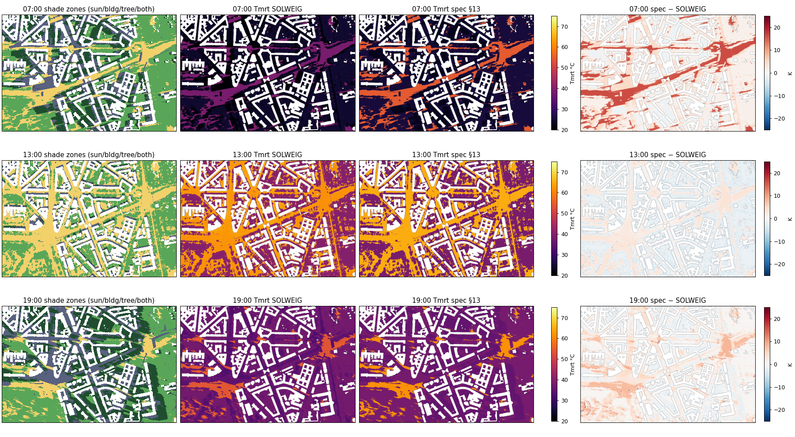
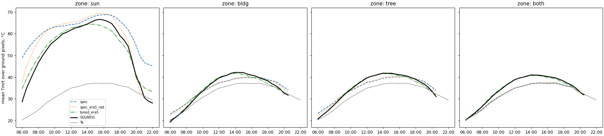
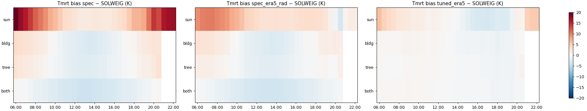
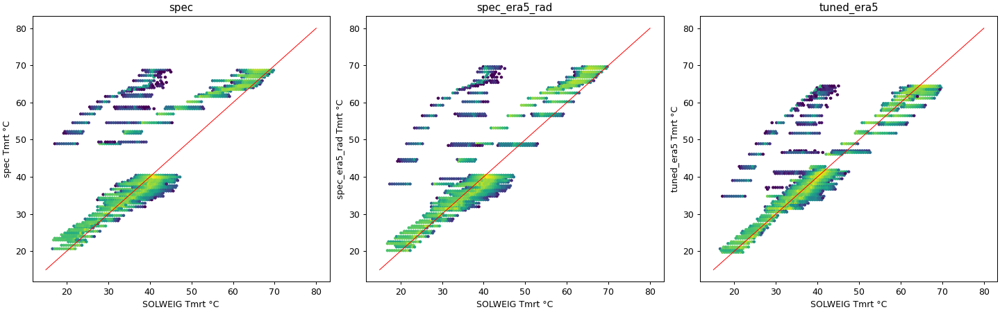
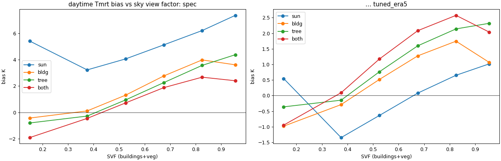
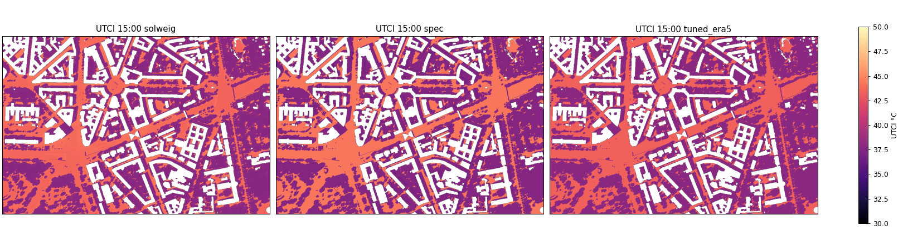
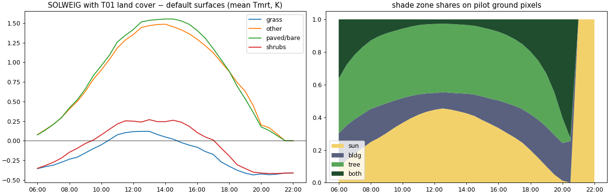

# T06 report: SOLWEIG reference on a pilot vs the spec §13 simple model

## Answers

- **Is SOLWEIG feasible without a GPU? Yes, if it is tiled.** On 8-vCPU Cloud Run tasks (CPU only), the UMEP Rust
  SOLWEIG (`solweig`) costs about 63–86 s per Mpx for the one-off sky view factor (SVF) and 1.5–2.1 s per Mpx per time
  step. The whole district as **one** call does not fit in 3 h: SVF alone was heading for ~6 h, because every pixel's
  rays are sized for the tallest building in the grid (Varso 310 m). As **27 tiles of 1 km** with a 500–1000 m caster
  halo, it ran in about 2 h 15 min of wall time (00:47–03:02 UTC incl. relaunches and mosaic; ~55 vCPU-h) on 5 regions' Cloud Run tasks (see [District run](#district-run)).
- **Do the 33 snapshots matter? Linearly, but they are not the bottleneck.** Runtime ≈ SVF + N_steps × step. At tile
  size, 33 steps cost 0.6–1.2× the SVF. Hourly steps would save ~25–30 %, 15-min steps would add ~50 %. The SVF depends
  only on geometry and can be reused for any day or scenario. Area × halo and the tallest building per tile matter more.
- **Is the §13 simple model good enough?** As written, no: daytime Tmrt RMSE 4.2 K vs SOLWEIG, up to +16 K in the sun at
  low sun, +17 K at night (the 2° sun clip gives full shortwave after sunset). **Tuned** (same structure, 12
  coefficients, T05 radiation): RMSE 2.0 K on a spatial hold-out; UTCI RMSE 0.5 K; heat-dose RMSE 1.4 per step. This is
  close to SOLWEIG's own sensitivity to surface parameters (land cover on/off: Tmrt RMSE 1.5 K, dose 1.1).
- **Decision (2026-10-18):** district SOLWEIG is the production thermal model; the §13 simple model is dropped. T07
  reads the tiles in `T06/district/tiles/{e}_{n}/` and the 33-band district COGs in `T06/district/`. The comparison
  below remains as the record of why: the simple model as written misses by 4 K, and even tuned it loses the spatial
  detail SOLWEIG gives at low sun (see ranking agreement).

## Setup

**Pilot (fixed bbox, EPSG:2180).** Core E 637300–638500, N 485100–485900 (1200 × 800 m = 0.96 km², 0.96 Mpx at 1 m). It
contains Plac Konstytucji, Plac Zbawiciela, the Marszałkowska canyon, Mokotowska, Aleje Ujazdowskie and the western
edge of Park Ujazdowski. SOLWEIG ran on the core plus a 500 m halo for shadow casters: 2200 × 1800 m = 3.96 Mpx.
Everything is compared on the core's ground pixels (not building, not water).

**Inputs.**
- Geometry: T01 1 m tiles (`gs://hackaton-honory-heat/T01/tiles/*.npz`), mosaicked: DSM = buildings (2025 flight) on
  DTM, DEM = T01 DTM, CDSM = T01 canopy height (2023 leaf-on, relative). Trunk zone left at SOLWEIG's default
  (25 % of canopy height); T01's measured crown base was not used, as the brief asks for defaults.
- Forcing: T05 `forcing_20260628` for all 33 steps (Okęcie + Obserwatorium II offset for Ta, Okęcie RH/wind, ERA5
  GHI/DNI/DHI with closure, pvlib sun). Three spin-up steps (02:30–03:30Z) from ERA5 warm the ground-temperature lag
  and are dropped from the analysis.
- `pmwc`: T05 `pmwc_10m.tif` (nearest to 1 m). Used only as a diagnostic (see below); the main comparison uses
  `pmwc = 0` so both models see the same air temperature.

**SOLWEIG.** [`solweig`](https://github.com/UMEP-dev/solweig) 0.1.0b96, the UMEP-dev Rust re-implementation of UMEP
SOLWEIG (parity-tested against UMEP Python). CPU only (`solweig.disable_gpu()`), isotropic sky, standing person, default
tree transmissivity (0.03 leaf-on) and default surfaces (no land cover). A second run with T01 surface types mapped to
UMEP land cover (paved, building, grass, water) tests surface sensitivity. Per-step outputs: shadow, Tmrt.

Why this implementation:
- UMEP-processing's Python SOLWEIG works without QGIS, but it is the slow reference code (pure numpy, one core).
- SOLWEIG-GPU (PyTorch) is built for GPUs. `hackaton-honory` has 0 GPU quota (`GPUS_ALL_REGIONS = 0`).
- `solweig` (Rust, multi-threaded) is by the UMEP developers and runs on CPU. It is the cheapest way to answer
  whether a GPU is needed at all.

**Shade zones for the simple model.** SOLWEIG's own shadow function (`calculate_shadows_wall_ht_25`, same DSM/CDSM/TDSM
and sun as the run) gives building shadow per pixel and step. Its vegetation shadow is cleared where buildings already
shade, so vegetation shadow on its own comes from a second pass over terrain + canopy only. Zones: `sun` (neither),
`bldg` (building only), `tree` (vegetation only), `both`. Shares are 0/1 per 1 m pixel. Their union matches SOLWEIG's
own shadow output on 99.5–99.8 % of ground pixels per daytime step (`zone_vs_solweig_shadow_agreement`; the zones
rebuild SOLWEIG's canopy layers from T01, which differs slightly at crown edges). T02's shares were not on the bucket
yet; repeating the fit with them is an open issue.

**Simple model variants** (all with `pmwc = 0` unless named):

| Variant | What changes |
|---|---|
| `spec` | §13 exactly as written (night: sun clipped to 2°, all pixels "sun") |
| `spec_night_off` | as `spec`, but no shortwave and no sun-driven surface term when the sun is below the horizon |
| `spec_readme_tau` | transmissivities from `tasks/README.md` (1, 0.1, 0.2, 0.08) |
| `spec_era5_rad` | T05 DNI/DHI instead of the parametric clear-sky irradiance; night off |
| `spec_pmwc` | `spec` with T05 `pmwc` |
| `tuned_clearsky` | same structure, per zone: Tmrt − Ta = τ_z·ΔT_sw,max + a_z·sin(alt) + b_z, parametric irradiance |
| `tuned_era5` | as `tuned_clearsky`, with T05 DNI/DHI in ΔT_sw,max |
| `tuned_era5_svf` | `tuned_era5` + c_z·(1 − SVF) per zone |
| `tuned_era5_pmwc` | `tuned_era5` + c·pmwc |

Fits are ordinary least squares on 400k random daytime ground pixel-steps from the **western half** of the core and
are reported on the eastern half (spatial hold-out) and on the whole core.

UTCI: `pythermalcomfort.models.utci` 4.6.2 with T05 10 m wind (`wind_10m_utci_ms` = max(0.5, wind), T05's documented
choice) and the step's Ta/RH. Values outside the validity range stay NaN and are counted.

## Runtime and scaling

All runs: Cloud Run jobs, 8 vCPU (unless noted), CPU only, isotropic sky, 36 steps (3 spin-up + 33). SVF and
walls come from SOLWEIG's own log timestamps (`gs://hackaton-honory-heat/T06/timings/*.json`).

| Domain | Mpx | Tallest building | Walls | SVF (once) | 36 steps | Per step |
|---|---|---|---|---|---|---|
| 256 × 256 m | 0.07 | 66 m | 1 s | 8 s | 3.5 s | 0.10 s |
| 512 × 512 m | 0.26 | 89 m | 2 s | 22 s | 16 s | 0.43 s |
| 1024 × 1024 m | 1.05 | 89 m | 3 s | 65 s | 79 s | 2.19 s |
| 1448 × 1448 m | 2.10 | 92 m | 4 s | 135 s | 148 s | 4.12 s |
| Pilot 2200 × 1800 m (10 threads) | 3.96 | – | 4 s | 342 s | 211 s | 5.85 s |
| Whole grid 8 × 9 km, one call | 72 | 310 m | 61 s | ~6 h (ETA, cancelled after 8/153 sky patches) | – | – |

Threads, 512 × 512 m: SVF 45 s (1 thread), 22 s (2, 4 and 8 threads); 36 steps 56 / 27 / 24 / 16 s. SVF stops
gaining after 2 threads; the time steps keep scaling.

Per step, cost follows sun height: 0.30 s at noon vs ~0.55 s at low sun (512 m tile), because the shadow ray-march
gets longer. Night steps skip shadows.

What drives the cost:
- **SVF:** about 300 shadow passes (buildings and vegetation × 153 sky patches), each ray-marched up to
  min(H_max / tan(patch altitude), 1000 m), where H_max is the tallest building in the domain. Per pixel it is constant
  for a given H_max, which is why one call over the whole grid (H_max 310 m) is ~3× slower per pixel than the pilot.
- **Time steps:** linear in pixels and steps. At tile size, 33 steps ≈ 0.6–1.2× the SVF.

## Pilot comparison: SOLWEIG vs the §13 simple model

Daytime (sun above the horizon), 709,892 ground pixels × 30 steps. Bias = model − SOLWEIG.

| Variant | Tmrt bias | Tmrt RMSE | Tmrt RMSE, east hold-out | UTCI RMSE | Heat-dose RMSE |
|---|---|---|---|---|---|
| `spec` (as written) | +1.3 K | 4.2 K | 3.8 K | 1.1 K | 2.3 |
| `spec_readme_tau` | +2.4 | 4.3 | 4.0 | – | – |
| `spec_era5_rad` | +1.0 | 3.6 | 3.3 | 0.9 | 2.2 |
| `spec_pmwc` | +1.3 | 4.3 | 3.9 | – | – |
| `tuned_clearsky` | −0.1 | 2.2 | 2.0 | 0.5 | 1.5 |
| `tuned_era5` | −0.1 | 2.1 | 2.0 | 0.5 | 1.4 |
| `tuned_era5_svf` | 0.0 | 2.0 | 1.8 | 0.5 | 1.4 |
| SOLWEIG with T01 land cover | +0.8 | 1.6 | 1.4 | 0.4 | 1.1 |

Heat dose per step is the spec's g(U) = max(0, U−26) + max(0, U−32) + 2·max(0, U−38). The last row is not a
simple-model variant: it is how much SOLWEIG itself moves when surfaces change from its defaults to T01 land cover.

Mean Tmrt by zone (ground pixels, °C):

| Local time | Zone | SOLWEIG | spec | Pixels |
|---|---|---|---|---|
| 07:00 | sun | 38.8 | 54.6 | 127k |
| 07:00 | building shade | 22.3 | 25.3 | 149k |
| 13:00 | sun | 63.1 | 64.8 | 318k |
| 13:00 | building shade | 40.9 | 38.2 | 73k |
| 13:00 | tree shade | 40.8 | 38.3 | 299k |
| 13:00 | both | 40.0 | 35.9 | 20k |
| 19:00 | sun | 54.3 | 61.8 | 71k |
| 19:00 | tree shade | 36.9 | 38.1 | 231k |

### Where the simple model fails

- **Low sun (06:00–08:00, 18:00–20:30):** the parametric irradiance `880·sin^0.25` stays high near the horizon. In the
  sun the spec is +16 K at 07:00 and +7 K at 19:00. T05's ERA5 radiation removes about a third of the error.
- **After sunset:** the spec clips the sun to 2°, so at 21:00–22:00 every pixel still gets full-sun shortwave:
  Tmrt bias +16.7 K at night. With the sun term off it is +1.2 K (SOLWEIG night Tmrt ≈ Ta − 1 K).
- **Shade at midday:** the spec is 2.5–4 K too cool. In shade, Tmrt is driven by hot sunlit walls and pavement around
  the pixel, not by sunlight passing through the shade. The fit puts shade transmissivities at ≈ 0 and moves the
  heat into the sun-elevation term.
- **Open vs enclosed:** bias grows with sky view factor. In the sun the spec is +5 K in canyons and +7 K on open
  plazas. In shade it is −1 to −2 K in narrow canyons and +3 to +4 K in shade on open ground (fig 5). Adding
  c·(1 − SVF) per zone helps only a little (RMSE 2.1 → 2.0 K).
- **Evening pavement heat:** SOLWEIG's sun-zone Tmrt peaks at 15:30, two hours after the sun, and its ground
  stays warm into the evening. The tuned model has no memory term and follows the sun.
- **Spatial ranking** (Spearman of UTCI across ground pixels, per step, vs SOLWEIG; this is what a router uses): spec
  0.42 at 06:00, ~0.8 at midday, 0.04 at 20:00. Any zone-only model ranks pixels the same way, whatever its
  coefficients. Adding SVF gives 0.93 at 06:00 and 0.88 at 20:00 but ~0.75 at midday. SOLWEIG with land cover vs
  without: 0.83–0.99.

### Fitted coefficients (`tuned_era5`, recommended form had the simple model stayed)

Tmrt = Ta + τ_z·ΔT_sw,max(DNI, DHI) + a_z·sin(alt) + b_z, with ΔT_sw,max from §13 using T05 DNI/DHI:

| Zone | τ | a (K) | b (K) |
|---|---|---|---|
| sun | 0.44 | 15.2 | 3.8 |
| building shade | −0.09 | 9.5 | −1.0 |
| tree shade | −0.01 | 6.8 | −0.7 |
| both | −0.01 | 6.0 | −0.9 |

At night: Tmrt ≈ Ta − 1 K (no sun terms). In the spec's own parametrisation (clear-sky irradiance, GVF 0.40 kept) the
fit gives τ = (0.17, −0.19, −0.07, −0.05) and surface offsets at full sun of (67, 27, 19, 15) K. These are not
physical surface temperatures; they show that the §13 split into "transmitted sun" and "surface offset" does not match
how SOLWEIG distributes the heat.

### Surfaces and `pmwc`

- **Land cover** (T01 surface types → UMEP grass / paved / water): at 13:00 paved ground is +1.5 K Tmrt vs SOLWEIG's
  default surface, grass +0.1 K; in the evening grass is −0.4 K. Small next to sun/shade (~25 K).
- **`pmwc`:** pilot 5–95 % range −4.6…+3.6 K. Its correlation with the tuned model's midday residual is 0.13, and
  the fitted coefficient is 0.10 K per K vs the spec's 0.35. SOLWEIG has no observed surface temperature, so this
  only says that `pmwc` does not proxy the geometry effects SOLWEIG resolves; it does not test whether `pmwc` is real.

### UTCI validity

No NaN in any variant: Tmrt − Ta stayed within −30…+70 K on every ground pixel and step, and T05's raw 10 m wind
was within 0.5–17 m/s at all 33 steps (1–3 m/s), so the `max(0.5, wind)` floor never applied.

## District run

Outputs (`gs://hackaton-honory-heat/T06/district/`):
- `tmrt_20260628.tif`, `utci_20260628.tif`, `shadow_20260628.tif`: COG, EPSG:2180, 1 m, E 635000–641000 /
  N 484000–491000 (6000 × 7000), 33 bands 06:00–22:00 CEST (band description = local time), NaN outside the 27 tiles,
  overviews 2–16. Tmrt and UTCI in °C; shadow 1 = sunlit, 0 = shaded (SOLWEIG convention, vegetation partially
  transmissive).
- `tiles/{e0}_{n0}/`: the same three rasters per 1 km core, plus `timing.json`. `tiles_summary.json`, `plan.json`
  (tallest building within 1 km of each tile → halo).

Setup per tile: the same SOLWEIG configuration as the pilot (defaults, no land cover, isotropic sky, T05 forcing,
3 spin-up steps). Halo 500 m (9 tiles) or 1000 m where a building over 100 m stands within 1 km (18 tiles: PKiN,
Varso, Złota 44, Warsaw Spire area). 1000 m is SOLWEIG's own shadow-reach cap. For the 1000 m tiles the sky view
factor was computed on core + 300 m and padded into the full-halo run; on a synthetic test with a tower just outside
the margin this changed core Tmrt by 0.1 K on average (max 0.8 K).

| Tiles | Halo | Mpx | Wall time per tile | Peak RSS |
|---|---|---|---|---|
| 9 | 500 m | 4 | 9.4–14.7 min (mean 11.9), 4 vCPU | 8.8 GB |
| 18 | 1000 m | 9 | 14.4–19.8 min (mean 16.7), 8 vCPU | 19.2 GB |

Spot check (overview level): Tmrt p5/50/95 at 13:00 = 40 / 55 / 63 °C, at 06:00 = 18 / 22 / 28 °C; UTCI at 13:00 =
36 / 40 / 42 °C. No UTCI NaN in any tile.

What went wrong on the way (for anyone rerunning):
- `python:3.12-slim` lacks `libexpat1`, so rasterio's bundled GDAL fails to import and `solweig` reports "Neither
  rasterio nor GDAL could be imported". Fixed in the Dockerfile.
- europe-central2 had no capacity for 8-vCPU tasks and preempted one 4-vCPU task; only 5 Cloud Run regions can be
  initialised in this project; 40 GiB memory per region binds before 20 vCPU.
- 1000 m-halo tiles OOM at 20 GiB (Cloud Run's `/tmp` is RAM and holds SOLWEIG's SVF cache); 32 GiB works.
- SOLWEIG rejects a precomputed SVF memmap whose input hash differs from the DSM; an `svfs.zip` without metadata is
  accepted by shape.

Not done:
- T02 shade was not used inside SOLWEIG: `solweig` takes precomputed SVF but not external shadows, and T02's SVF has
  2 of the 15 grids it needs. A patched build could take T02's measured crown base and transmission.
- Tile seams: each core uses its own halo, so values are continuous across seams except where the SVF margin
  (300 m) or halo misses a caster; not checked visually yet.
- Land cover: the district run uses SOLWEIG's default surfaces like the pilot reference; with T01 land cover, paved
  ground would be ~1.5 K warmer at midday.
