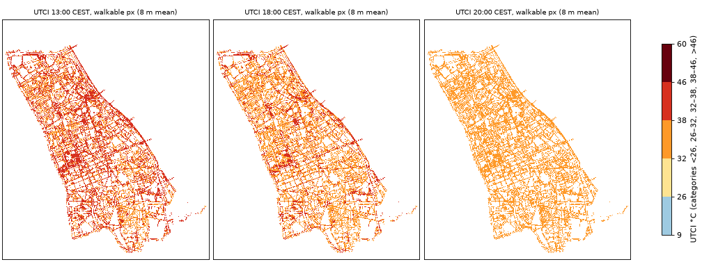
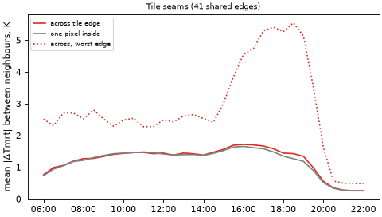
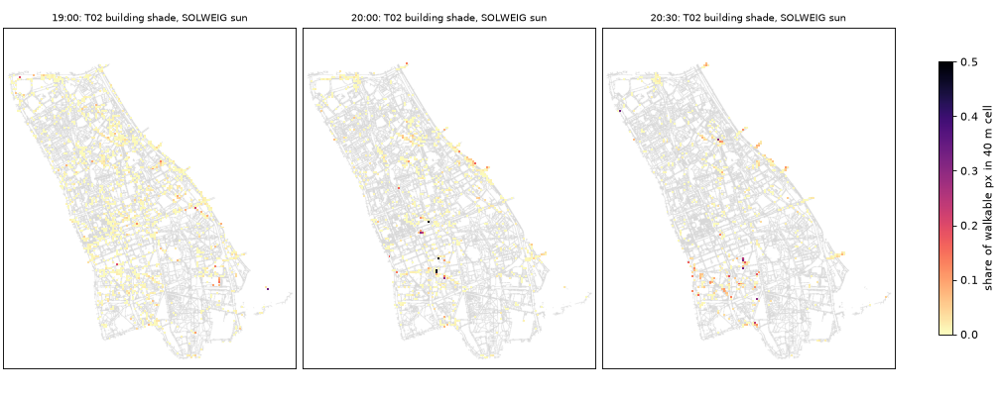
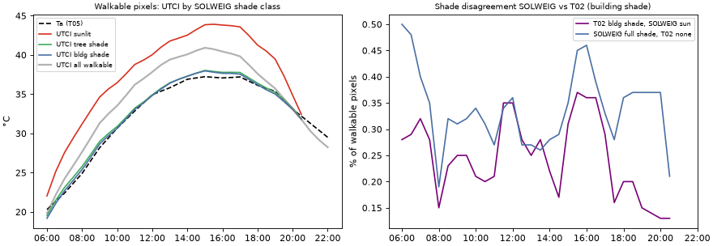

# T07 report: UTCI field from the district SOLWEIG run

Brief: [tasks/T07](../../tasks/T07_utci_field.md). Code: [`utci/`](../../utci/). Bucket README: `gs://hackaton-honory-heat/T07/README.md`.

## Answers

- **Coverage: complete inside the AOI.** 2,230,894 of 2,231,803 walkable pixels (99.96 %) have Tmrt and UTCI at
  all 33 steps. The 909 without are all outside the AOI, in the mask's 50 m fringe beyond the 27 tile cores; 15 of
  57,169 T03 segments lose all their pixels (26 lose some). No NaN in UTCI on any covered pixel and step.
- **Tile seams: none from SOLWEIG.** Over 41 shared tile edges the Tmrt difference across an edge is the same as one
  pixel inside (mean 1.22 K vs 1.19 K; shadow flips 4.8 % vs 4.7 %), including the 7 edges where a 500 m-halo tile
  meets a 1000 m one. The one visible seam (E 638000, N 488000–489000, up to 4.7 K mean jump 15:00–20:00) is a
  **1–3 m step in the T01 DTM at its tile boundary**, which casts a real-looking shadow in both SOLWEIG and T02.
- **Far casters: small and only at 20:00–20:30.** Pixels where T02 has building shade and SOLWEIG has sun are 0.13–0.37 %
  of walkable pixels at every step, the same at noon as at sunset: mostly 1–2 px shadow-edge differences. Only at
  20:00 and 20:30 are many of them true far shadows: 31 % (20:00) and 62 % (20:30) of them have T02's caster more than
  1 km away (towers, median caster height 108–153 m above the pixel). That is ≈ 900 and ≈ 1,700 walkable pixels, worth
  1.8 K and 0.6 K of UTCI each; averaged over the walkable area it is < 0.01 K. SOLWEIG would not see them even with a
  bigger halo: `solweig` caps shadow reach at `max_shadow_distance_m = 1000` by default, which T06 kept.
- **Ground-temperature sign: correct (−3.41 K), not a bug.** `solweig` 0.1.0b96 uses the land-cover-path value without
  a land-cover grid. Had it used UMEP `Solweig_run.py`'s +3.41 K, sunlit Tmrt would be 2.1–2.9 K and UTCI 0.5–0.8 K
  higher in the afternoon. No rerun needed.
- **Pilot consistency: identical.** On the 0.96 Mpx pilot core the district tiles reproduce the T06 pilot to
  ≤ 0.006 K MAE at every step; shadows agree on 99.85–100 % of pixels (the halo going from 500 m to 1000 m changed
  0.15 % of pixels at 20:30–21:00, nothing before).
- **Sanity: passes.** Tmrt − Ta stays within −5.5…+32.6 K on every walkable pixel and step (valid range −30…+70);
  wind input 1.0–3.0 m/s (valid 0.5–17). Sun vs building shade at 13:00: Tmrt 63.0 vs 40.7 °C, UTCI 41.8 vs 36.4 °C
  (+5.4 K), peaking at +6.2 K UTCI at 16:00. Tree shade and building shade give almost the same UTCI (within 0.35 K). In the
  evening UTCI converges on Ta: at 20:00 33.2 vs Ta 33.1 °C; after sunset it drops 1–1.3 K *below* Ta (21:00 30.3 vs
  31.3) because SOLWEIG has no pavement heat release (accepted limit, spec §6).
- **Indoor and underground** segments have no pixels in the T03 mask, so no values here; T08 applies its own rule.

## What was produced

| Output | Where | Notes |
|---|---|---|
| `utci.tif` | `gs://hackaton-honory-heat/T07/` | float32 COG, UTCI °C, 33 bands, NaN outside the walkable mask. **Hand-over to T08** |
| `tmrt.tif` | same | float32 COG, Tmrt °C, same layout |
| `sun_solweig.tif` | same | uint8 COG, SOLWEIG `shadow` × 250 (250 sun, 0 building shade, ≈ 8 under crowns), 255 = nodata or night |
| `checks/checks.json` | same | every number in this report: coverage, seams, far casters (+ caster-distance sample), pilot, sanity per step |
| `checks/previews_8m.npz`, `checks/run_{0,1,2}.json` | same | 8 m block means for the figures; tiles used and runtime per task |
| `README.md`, `_SUCCESS` | same | `_SUCCESS` = final rasters from all 27 tiles and the README are uploaded |

All rasters are on the shared grid (EPSG:2180, 1 m, E 634000–642000, N 483000–492000, 8000 × 9000), bands
= 33 steps 06:00–22:00 CEST with T02's band descriptions (`2026-06-28T06:00:00+02:00 (04:00Z) az=68.0 el=12.58`).
Values are copied unchanged from the 27 T06 tile cores (`T06/district/tiles/{e0}_{n0}/`); only the T03 walkable
mask (`walkable.tif > 0`) is applied, so they are the same numbers as the T06 mosaic. UTCI is T06's (pythermalcomfort,
T05 `ta_c`, `rh_pct`, max(0.5, 10 m wind)); T07 does not recompute it.

**How:** Cloud Run Job `t07-final` (image `t07-utci:3`, europe-west4), 3 tasks × 6 vCPU / 12 GiB: task 0 runs the
checks and writes `utci.tif`, task 1 `tmrt.tif`, task 2 `sun_solweig.tif`. No task holds a full 33-band raster: each
reads the 27 tiles, keeps only the walkable pixels as vectors (≈ 2.1 M px × 33 steps), runs the checks on those
vectors, then writes its output band by band and converts it to COG (the COG conversion with average overviews
is the slow part, ≈ 11 min per raster). _RUNTIME_

## Coverage

27 of 27 tiles. The tile cores (E 635000–641000, N 484000–491000, 27 km²) contain the whole AOI.

| | pixels |
|---|---|
| walkable (T03 mask > 0) | 2,231,803 |
| walkable inside the 27 tile cores (have values) | 2,230,894 |
| walkable outside the tiles (nodata) | 909, of which inside the AOI: 0 |
| walkable outside the AOI (mask fringe ≤ 50 m) | 98,749, of which 97,840 are still inside a tile |

The 909 uncovered pixels are plaza (465), park path (178), sidewalk (147), shared street (118) and steps (1), in
1 km cells next to the AOI that T06 did not run. They touch 26 T03 segments; 15 have no pixel left and need a
fallback in T08 (nearest covered segment, or the Ta-based night/evening value). Map: [`coverage.png`](coverage.png).

## Tile seams

For each of the 41 shared edges and each step, the job compares the mean |ΔTmrt| between the two pixel lines on
either side of the edge with the mean |ΔTmrt| between the edge line and the line one pixel inside each tile (the
normal pixel-to-pixel texture), and the same for sun/shade flips.

- Across all edges and steps: 1.22 K across vs 1.19 K inside, flips 4.8 % vs 4.7 %. No systematic jump, also not on the
  7 edges where halos differ (500 m vs 1000 m): all ≤ 1.1 K except the one below.
- **E 638000, N 488000–489000 (637000_488000 · 638000_488000):** mean jump up to 4.7 K and 25 % flips from 15:00 to 20:00.
  Cause: the T01 DTM drops by 0.2 m on average and up to 3.4 m (1.1 m over N 488700–488900) exactly at E 638000, a tile
  boundary of the T01 mosaic. With the sun in the west the step shades the first 1–3 m east of it. T02 shows the same
  shade strip (SOLWEIG and T02 agree there), so it is a geometry artefact, not a SOLWEIG one. Across all edges the DTM
  step size correlates with the Tmrt jump (r = 0.70).

Edges with a mean jump ≥ 1 K at any step (all 41 in `checks.json` → `seams`):

| Edge | orient. | halos | Tmrt MAE across / inside (max over steps) K | max \|mean jump\| K | shadow flips across / inside (max) |
|---|---|---|---|---|---|
| 635000_490000 · 635000_489000 | h | 1000/1000 | 3.79 / 2.94 | 1.43 | 0.223 / 0.204 |
| 636000_490000 · 637000_490000 | v | 1000/1000 | 1.37 / 0.87 | 1.20 | 0.102 / 0.065 |
| 637000_488000 · 638000_488000 | v | 1000/500 | 5.54 / 2.76 | 4.68 | 0.250 / 0.102 |
| 638000_485000 · 639000_485000 | v | 1000/500 | 2.49 / 1.92 | 1.10 | 0.086 / 0.074 |
| 639000_486000 · 640000_486000 | v | 500/500 | 1.54 / 1.43 | 1.07 | 0.133 / 0.071 |

## Far casters at low sun

Per sunlit step, on walkable pixels: T02 building shade `B = (f_bldg + f_both) / 250 ≥ 0.5` (cast over the 13 × 11 km
caster extent) vs SOLWEIG sunlit (`shadow ≥ 0.5`). For the steps from 17:00 a sample of up to 3,000 disagreeing pixels was
ray-marched towards the sun over T01 `dsm` + T02 `far_casters/dsm_far.tif` to find T02's caster and its distance.

| Local | sun el ° | T02 bldg shade % | SOLWEIG full shade % | T02 shade, SOLWEIG sun: px | % of walkable | % of T02 shade | SOLWEIG shade, T02 none % | ΔUTCI sun−shade K | mean UTCI excess K |
|---|---|---|---|---|---|---|---|---|---|
| 06:00 | 12.6 | 50.7 | 50.7 | 6,176 | 0.28 | 0.55 | 0.50 | 2.9 | 0.008 |
| 06:30 | 16.9 | 44.6 | 44.6 | 6,427 | 0.29 | 0.65 | 0.48 | 4.1 | 0.012 |
| 07:00 | 21.3 | 39.8 | 39.7 | 7,041 | 0.32 | 0.79 | 0.40 | 4.8 | 0.015 |
| 07:30 | 25.9 | 35.4 | 35.3 | 6,160 | 0.28 | 0.78 | 0.35 | 5.4 | 0.015 |
| 08:00 | 30.5 | 31.6 | 31.6 | 3,296 | 0.15 | 0.47 | 0.19 | 5.8 | 0.009 |
| 08:30 | 35.0 | 28.6 | 28.6 | 5,072 | 0.23 | 0.80 | 0.32 | 5.9 | 0.014 |
| 09:00 | 39.6 | 25.6 | 25.6 | 5,475 | 0.25 | 0.96 | 0.31 | 6.0 | 0.015 |
| 09:30 | 44.0 | 23.0 | 23.0 | 5,496 | 0.25 | 1.07 | 0.32 | 6.0 | 0.015 |
| 10:00 | 48.1 | 20.4 | 20.5 | 4,792 | 0.21 | 1.05 | 0.34 | 5.8 | 0.012 |
| 10:30 | 52.0 | 17.8 | 17.8 | 4,361 | 0.20 | 1.10 | 0.31 | 5.7 | 0.011 |
| 11:00 | 55.4 | 15.2 | 15.2 | 4,775 | 0.21 | 1.41 | 0.27 | 5.7 | 0.012 |
| 11:30 | 58.2 | 13.5 | 13.4 | 7,757 | 0.35 | 2.57 | 0.34 | 5.5 | 0.019 |
| 12:00 | 60.1 | 12.6 | 12.5 | 7,749 | 0.35 | 2.76 | 0.36 | 5.2 | 0.018 |
| 12:30 | 61.0 | 13.1 | 13.1 | 6,247 | 0.28 | 2.13 | 0.27 | 5.3 | 0.015 |
| 13:00 | 60.8 | 14.3 | 14.2 | 5,632 | 0.25 | 1.77 | 0.27 | 5.4 | 0.014 |
| 13:30 | 59.5 | 15.4 | 15.3 | 6,236 | 0.28 | 1.82 | 0.26 | 5.2 | 0.015 |
| 14:00 | 57.2 | 16.3 | 16.3 | 4,981 | 0.22 | 1.37 | 0.28 | 5.2 | 0.012 |
| 14:30 | 54.1 | 17.2 | 17.2 | 3,745 | 0.17 | 0.98 | 0.29 | 5.6 | 0.009 |
| 15:00 | 50.5 | 18.6 | 18.6 | 6,874 | 0.31 | 1.65 | 0.35 | 5.9 | 0.018 |
| 15:30 | 46.5 | 20.2 | 20.2 | 8,234 | 0.37 | 1.83 | 0.45 | 6.1 | 0.023 |
| 16:00 | 42.3 | 22.8 | 22.7 | 8,044 | 0.36 | 1.58 | 0.46 | 6.2 | 0.022 |
| 16:30 | 37.8 | 26.3 | 26.2 | 7,944 | 0.36 | 1.35 | 0.39 | 6.1 | 0.022 |
| 17:00 | 33.3 | 30.5 | 30.4 | 6,388 | 0.29 | 0.94 | 0.33 | 6.0 | 0.017 |
| 17:30 | 28.7 | 35.3 | 35.3 | 3,673 | 0.16 | 0.47 | 0.28 | 5.6 | 0.009 |
| 18:00 | 24.1 | 41.4 | 41.4 | 4,530 | 0.20 | 0.49 | 0.36 | 5.0 | 0.010 |
| 18:30 | 19.6 | 48.4 | 48.4 | 4,431 | 0.20 | 0.41 | 0.37 | 4.9 | 0.010 |
| 19:00 | 15.2 | 56.5 | 56.5 | 3,444 | 0.15 | 0.27 | 0.37 | 4.5 | 0.007 |
| 19:30 | 10.9 | 66.0 | 66.0 | 3,129 | 0.14 | 0.21 | 0.37 | 3.3 | 0.005 |
| 20:00 | 6.9 | 77.9 | 77.9 | 2,915 | 0.13 | 0.17 | 0.37 | 1.8 | 0.002 |
| 20:30 | 3.1 | 94.8 | 94.0 | 2,799 | 0.13 | 0.13 | 0.21 | 0.6 | 0.001 |

**Where is T02's caster?** Sample of missed pixels, ray-marched towards the sun on T01 dsm + T02 far-caster surface:

| Local | missed px | sample | dist p10 / p50 / p90 m | ≤ 200 m | 200–500 m | 500–1000 m | > 1000 m | beyond tile halo | none found | caster height p50 m |
|---|---|---|---|---|---|---|---|---|---|---|
| 17:00 | 6,388 | 3000 | 20 / 20 / 99 | 4 % | 0 % | 0 % | 0 % | 0 % | 96 % | 14.5 |
| 17:30 | 3,673 | 3000 | 17 / 17 / 253 | 5 % | 1 % | 0 % | 0 % | 0 % | 95 % | 27.2 |
| 18:00 | 4,530 | 3000 | 27 / 50 / 66 | 4 % | 0 % | 0 % | 0 % | 0 % | 95 % | 23.1 |
| 18:30 | 4,431 | 3000 | 11 / 29 / 129 | 7 % | 0 % | 0 % | 0 % | 0 % | 93 % | 18.3 |
| 19:00 | 3,444 | 3000 | 11 / 55 / 287 | 7 % | 1 % | 0 % | 0 % | 0 % | 92 % | 19.7 |
| 19:30 | 3,129 | 3000 | 40 / 82 / 979 | 5 % | 0 % | 1 % | 1 % | 1 % | 93 % | 21.0 |
| 20:00 | 2,915 | 2915 | 3 / 1193 / 1372 | 10 % | 1 % | 0 % | 31 % | 31 % | 57 % | 152.5 |
| 20:30 | 2,799 | 2799 | 914 / 1455 / 2541 | 5 % | 1 % | 0 % | 62 % | 62 % | 31 % | 108.5 |

Missed pixel-steps 19:00–20:30 by tile (top 8): 637000_488000 2,088, 637000_485000 1,562, 637000_486000 1,514, 638000_488000 935, 637000_487000 887, 636000_488000 587, 638000_487000 586, 636000_489000 483

- From 06:00 to 19:30 the disagreement is a flat 0.15–0.37 % in both directions, and the ray-march finds no caster for
  92–96 % of the sample: these are shadow-edge pixels (1–2 px), not missing shadows.
- At 20:00 and 20:30 the far shadows appear: 31 % and 62 % of the missed pixels have a caster > 1 km away (the tiles'
  halo is 500–1000 m), with median caster height 153 m and 109 m above the pixel, i.e. the Wola and Śródmieście
  towers. Hot spots: tiles 637000_485000–637000_488000 and 638000_488000 (Marszałkowska, Plac Konstytucji, Powiśle
  edge), map [`far_casters_map.png`](far_casters_map.png).
- Effect: ≈ 900 (20:00) and ≈ 1,700 (20:30) walkable pixels are sunlit in SOLWEIG but shaded in reality; at those
  steps sun vs shade is worth 1.8 K and 0.6 K UTCI. The area-mean error is < 0.01 K. Routes along the affected streets
  are priced ≤ 1.8 K UTCI too warm for at most 2 steps.
- A larger halo would not fix it alone: `solweig.calculate(max_shadow_distance_m=…)` defaults to 1000 m and T06 used
  the default, so SOLWEIG never casts a shadow longer than 1 km. A fix would be both a 6 km caster ring and a larger
  `max_shadow_distance_m`, or using T02's B for the last steps. Not done: the effect is too small to justify a rerun.

## Ground-temperature sign (no land-cover run)

**Verdict: no bug in our runs.** `solweig` 0.1.0b96 applies **Tstart = −3.41 K** when no land-cover grid is given,
the same value as UMEP's land-cover path and the Lindberg et al. (2008) regression (ground-temperature amplitude
`Tgamp = TgK · altmax + Tstart = 0.37 · 61.3° − 3.41 ≈ 19.3 K` on 2026-06-28). It does **not** copy UMEP
`Solweig_run.py`'s no-land-cover branch (`Tstart = Knight − (−3.41) = +3.41 K`, amplitude ≈ 26.1 K).

- **Source:** `solweig/models/surface.py`, `SurfaceData.get_land_cover_properties()`: with `land_cover is None` it
  returns `tstart = np.full_like(dsm, -3.41)`, `tgk = 0.37`, `tmaxlst = 15.0`, albedo 0.15, emissivity 0.95
  (`loaders.py` uses the same −3.41 default for unmatched classes). `components/ground.py` documents the formula
  `Tgamp = TgK * altmax + Tstart`, and `computation.py` passes the `tstart` grid unchanged to the Rust pipeline.
- **Run:** [`utci/tstart_check.py`](../../utci/tstart_check.py), a synthetic 160 × 160 m flat scene with one 20 m block,
  T05 forcing, three runs: A = no land cover (our setup), B = land cover cobblestone with Tstart = −3.41 and albedo
  0.15, C = the same with Tstart = +3.41. On an open sunlit ground pixel A and B agree to 0.02–0.25 K at every step,
  so the default is −3.41. Result: [`tstart_check.json`](tstart_check.json).
- **Size of the effect, had the UMEP no-land-cover sign been used (C − A, open sunlit ground):**

| Local time | Ta °C | Tmrt A (ours) | Tmrt C (+3.41) | ΔTmrt K | ΔUTCI K |
|---|---|---|---|---|---|
| 12:00 | 34.9 | 59.1 | 61.2 | +2.1 | +0.5 |
| 13:00 | 35.8 | 60.2 | 62.5 | +2.3 | +0.5 |
| 15:00 | 37.2 | 63.3 | 66.0 | +2.7 | +0.7 |
| 17:00 | 37.2 | 62.2 | 65.1 | +2.9 | +0.8 |
| 20:00 | 33.1 | 38.5 | 40.9 | +2.4 | +0.7 |

  The 6.8 K difference in ground-temperature amplitude reaches Tmrt only through the ground's upward longwave
  (and less through walls), so it is ≈ 2–3 K of Tmrt and ≈ 0.5–0.8 K of UTCI in full sun, zero at night, smaller in
  shade (shaded ground has no excess in this scheme). Elsewhere in the scene A and B differ by up to 5 K at some pixels
  and steps (not traced: passing a land-cover grid changes more than Tstart); the open sunlit pixel is the clean
  comparison and is what the sign question is about.
- **Decision left to the user:** none needed for correctness. If one preferred UMEP's no-land-cover behaviour, the
  field would be ≈ 0.5–0.8 K UTCI warmer in the sun; this would not change the sun/shade ranking the router uses.

## Pilot consistency

The T06 pilot (E 637300–638500, N 485100–485900, 500 m halo, SVF on the full domain) vs the district tiles 637000_485000
and 638000_485000 (1000 m halo, SVF on core + 300 m), all 960,000 pixels:

| Local | n | Tmrt bias K | MAE K | p99 |Δ| K | share |Δ| > 1 K | shadow agreement |
|---|---|---|---|---|---|---|
| 06:00 | 960,000 | 0.000 | 0.000 | 0.000 | 0.0000 | 1.0000 |
| 09:00 | 960,000 | -0.000 | 0.000 | 0.001 | 0.0000 | 1.0000 |
| 13:00 | 960,000 | -0.000 | 0.000 | 0.001 | 0.0000 | 1.0000 |
| 17:00 | 960,000 | -0.000 | 0.000 | 0.001 | 0.0000 | 1.0000 |
| 19:00 | 960,000 | -0.000 | 0.000 | 0.000 | 0.0000 | 1.0000 |
| 20:00 | 960,000 | -0.000 | 0.000 | 0.000 | 0.0000 | 1.0000 |
| 20:30 | 960,000 | -0.006 | 0.006 | 0.000 | 0.0015 | 0.9985 |
| 21:00 | 960,000 | -0.003 | 0.003 | 0.000 | 0.0015 | 1.0000 |
| 22:00 | 960,000 | -0.000 | 0.000 | 0.000 | 0.0000 | 1.0000 |

The 300 m SVF margin and the larger halo change nothing measurable; the only difference is 0.15 % more shade at
20:30–21:00 from a caster between 500 and 1000 m.

## Sanity per step (walkable pixels)

Shade classes from SOLWEIG `shadow`: sun ≥ 0.98, building shade = 0, tree shade 0–0.5. Out of range = Tmrt − Ta
outside −30…+70 K.

| Local | Ta | Tmrt−Ta p1 / p50 / p99 (min, max) | out of range | UTCI NaN | UTCI mean | UTCI sun | UTCI tree shade | UTCI bldg shade | Tmrt sun | Tmrt bldg shade | sunlit % |
|---|---|---|---|---|---|---|---|---|---|---|---|
| 06:00 | 20.3 | -3.4 / 0.3 / 10.6 (-3.4, 12.4) | 0 | 0 | 19.8 | 22.0 | 19.5 | 19.2 | 28.7 | 19.3 | 19 |
| 06:30 | 21.4 | -2.6 / 1.3 / 15.3 (-2.6, 16.7) | 0 | 0 | 22.2 | 25.1 | 21.5 | 21.1 | 34.5 | 20.9 | 24 |
| 07:00 | 22.4 | -2.1 / 1.7 / 18.4 (-2.2, 19.5) | 0 | 0 | 24.2 | 27.6 | 23.1 | 22.7 | 38.8 | 22.3 | 29 |
| 07:30 | 23.6 | -1.6 / 2.3 / 21.1 (-1.7, 22.2) | 0 | 0 | 25.9 | 29.4 | 24.4 | 24.0 | 43.0 | 23.9 | 33 |
| 08:00 | 24.9 | -1.0 / 2.7 / 23.7 (-1.2, 24.6) | 0 | 0 | 27.6 | 31.2 | 25.8 | 25.4 | 46.9 | 25.8 | 37 |
| 08:30 | 26.5 | -0.6 / 2.9 / 25.1 (-1.0, 25.9) | 0 | 0 | 29.5 | 32.9 | 27.4 | 27.0 | 49.9 | 27.8 | 40 |
| 09:00 | 28.2 | -0.2 / 3.4 / 26.2 (-0.7, 26.9) | 0 | 0 | 31.3 | 34.6 | 29.0 | 28.7 | 52.6 | 29.9 | 43 |
| 09:30 | 29.4 | 0.6 / 4.2 / 27.5 (-0.2, 28.2) | 0 | 0 | 32.5 | 35.7 | 30.0 | 29.7 | 55.2 | 31.8 | 46 |
| 10:00 | 30.7 | 1.0 / 4.6 / 28.0 (-0.2, 28.8) | 0 | 0 | 33.5 | 36.5 | 30.9 | 30.6 | 56.8 | 33.4 | 48 |
| 10:30 | 31.8 | 1.5 / 25.0 / 28.7 (-0.1, 29.5) | 0 | 0 | 34.8 | 37.6 | 32.0 | 31.8 | 58.4 | 35.0 | 51 |
| 11:00 | 32.8 | 2.1 / 25.9 / 29.4 (0.2, 30.1) | 0 | 0 | 36.2 | 38.8 | 33.2 | 33.1 | 60.1 | 36.6 | 54 |
| 11:30 | 33.9 | 2.4 / 25.6 / 29.0 (0.4, 29.9) | 0 | 0 | 37.0 | 39.3 | 34.0 | 33.9 | 60.8 | 37.9 | 56 |
| 12:00 | 34.9 | 2.8 / 25.5 / 29.1 (0.8, 29.9) | 0 | 0 | 37.8 | 40.0 | 34.9 | 34.8 | 61.7 | 39.4 | 57 |
| 12:30 | 35.4 | 3.1 / 25.9 / 29.6 (1.1, 30.4) | 0 | 0 | 38.7 | 41.0 | 35.8 | 35.6 | 62.6 | 40.1 | 57 |
| 13:00 | 35.8 | 3.1 / 25.9 / 29.6 (1.2, 30.5) | 0 | 0 | 39.4 | 41.8 | 36.5 | 36.4 | 63.0 | 40.7 | 56 |
| 13:30 | 36.4 | 3.3 / 26.1 / 29.7 (1.6, 30.7) | 0 | 0 | 39.8 | 42.1 | 36.9 | 36.9 | 63.8 | 41.5 | 54 |
| 14:00 | 36.9 | 3.3 / 26.3 / 29.9 (1.6, 30.8) | 0 | 0 | 40.1 | 42.5 | 37.3 | 37.3 | 64.5 | 41.9 | 53 |
| 14:30 | 37.1 | 3.0 / 26.9 / 30.7 (1.2, 31.7) | 0 | 0 | 40.5 | 43.2 | 37.7 | 37.7 | 65.5 | 41.8 | 52 |
| 15:00 | 37.2 | 2.5 / 9.2 / 31.5 (0.5, 32.3) | 0 | 0 | 40.9 | 43.9 | 38.0 | 38.0 | 66.3 | 41.7 | 50 |
| 15:30 | 37.2 | 2.0 / 6.2 / 31.8 (0.1, 32.6) | 0 | 0 | 40.7 | 43.9 | 37.9 | 37.8 | 66.7 | 41.1 | 48 |
| 16:00 | 37.1 | 1.7 / 5.2 / 31.5 (-0.3, 32.4) | 0 | 0 | 40.4 | 43.8 | 37.8 | 37.7 | 66.4 | 40.6 | 45 |
| 16:30 | 37.1 | 0.7 / 4.3 / 30.8 (-0.9, 31.8) | 0 | 0 | 40.2 | 43.7 | 37.8 | 37.6 | 65.8 | 40.2 | 41 |
| 17:00 | 37.2 | -0.1 / 3.5 / 29.8 (-1.4, 30.9) | 0 | 0 | 39.8 | 43.6 | 37.8 | 37.6 | 64.8 | 39.5 | 36 |
| 17:30 | 36.7 | -0.3 / 3.2 / 27.6 (-1.5, 29.2) | 0 | 0 | 38.8 | 42.5 | 37.1 | 36.9 | 62.3 | 38.8 | 32 |
| 18:00 | 36.1 | -0.7 / 3.0 / 25.1 (-1.6, 26.8) | 0 | 0 | 37.6 | 41.3 | 36.4 | 36.2 | 59.2 | 38.0 | 26 |
| 18:30 | 35.8 | -1.9 / 2.0 / 23.6 (-2.7, 25.8) | 0 | 0 | 36.6 | 40.5 | 35.8 | 35.6 | 57.4 | 36.6 | 21 |
| 19:00 | 35.4 | -2.7 / 1.4 / 21.1 (-3.6, 23.7) | 0 | 0 | 35.7 | 39.5 | 35.2 | 35.0 | 54.5 | 35.7 | 15 |
| 19:30 | 34.2 | -3.0 / 0.9 / 15.1 (-3.6, 18.7) | 0 | 0 | 34.4 | 37.4 | 34.3 | 34.1 | 47.8 | 34.3 | 10 |
| 20:00 | 33.1 | -3.8 / -0.3 / 7.1 (-4.1, 12.0) | 0 | 0 | 33.2 | 34.9 | 33.2 | 33.0 | 39.7 | 32.5 | 5 |
| 20:30 | 32.2 | -4.4 / -1.0 / 2.2 (-4.7, 7.4) | 0 | 0 | 31.8 | 32.4 | 31.9 | 31.8 | 33.8 | 31.2 | 1 |
| 21:00 | 31.3 | -4.7 / -1.5 / 1.7 (-4.9, 4.5) | 0 | 0 | 30.3 | – | – | – | – | – | – |
| 21:30 | 30.4 | -5.4 / -2.2 / 1.1 (-5.5, 1.2) | 0 | 0 | 29.2 | – | – | – | – | – | – |
| 22:00 | 29.5 | -5.4 / -2.2 / 1.1 (-5.4, 1.2) | 0 | 0 | 28.2 | – | – | – | – | – | – |

Wind input range (UTCI): [1.0, 3.0] m/s.

- **Sun–shade difference:** UTCI sun − building shade is +5.2 to +6.2 K from 09:00 to 17:00 (Tmrt +22 to +26 K);
  plausible for a clear, calm, 37 °C day. Tree shade and building shade are within 0.35 K UTCI of each other (tree
  transmissivity 0.03).
- **Evening:** UTCI reaches Ta at 20:00 (33.2 vs 33.1 °C) and falls below it after sunset (21:00 −1.0 K, 22:00 −1.3 K)
  because SOLWEIG's default ground has no heat storage: the known, accepted limit (spec §6).

## Indoor and underground

T03 keeps indoor corridors and underground passages out of `walkable.tif`, so they have no pixels and no value
here. T08 prices them with its own rule.

## What we learned

- The district field is internally consistent: tile halos and the SVF margin leave no seams; the pilot is reproduced
  exactly. The only edge artefact comes from the T01 DTM mosaic.
- SOLWEIG shade agrees with T02 to within 0.4 % of walkable pixels at every step; the two shade engines were built
  independently.
- SOLWEIG's shadow reach is capped at 1 km by default (`max_shadow_distance_m`), on top of the halo.
- The no-land-cover ground scheme in `solweig` uses the published sign; UMEP's own no-land-cover branch differs.

## Open issues

- **909 walkable pixels / 15 segments outside the tiles** (all outside the AOI). T08 needs a fallback.
- **T01 DTM steps at tile boundaries** (worst E 638000, N 488000–489000, up to 3.4 m): fix in T01 (blend tiles) if T01
  is ever rerun; it creates a 1–3 m shade strip in the afternoon in both SOLWEIG and T02.
- **Far shadows beyond 1 km at 20:00–20:30** are missing (≈ 0.1 % of walkable pixels, ≤ 1.8 K UTCI there).
- **Evening:** no pavement heat release; 21:00–22:00 UTCI is ≈ 1–1.3 K below Ta (accepted).
- **Air temperature** is one park-station series for the whole district (cool side); the Filtry-adjusted sensitivity
  (`ta_filtry_adj_c`, +0.9…+2.1 K) was not run (optional in the brief).
- The UTCI here inherits T06's choices: 10 m wind without canyon reduction, standing person, isotropic sky.

## Where things are

- Code: [`utci/field.py`](../../utci/field.py) (Cloud Run job), [`utci/figures.py`](../../utci/figures.py),
  [`utci/report_tables.py`](../../utci/report_tables.py), [`utci/tstart_check.py`](../../utci/tstart_check.py),
  `utci/Dockerfile`, bucket README source `utci/BUCKET_README.md`.
- Image `europe-central2-docker.pkg.dev/hackaton-honory/hackathon/t07-utci:3`. Jobs: `t07-final` (europe-west4: the
  production run; also defined in europe-west1, unused), `t07-field` (europe-north1, test run on 22 tiles to `T07/test/`).
- Rerun: `gcloud run jobs execute t07-final --region europe-west4` (env `OUT_PREFIX=T07`, `REQUIRE_TILES=27`, 3 tasks).

