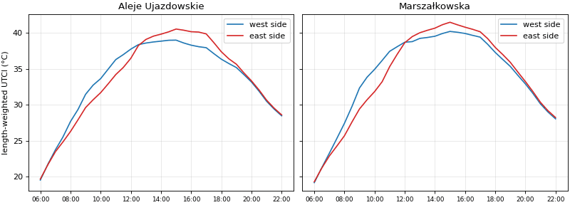
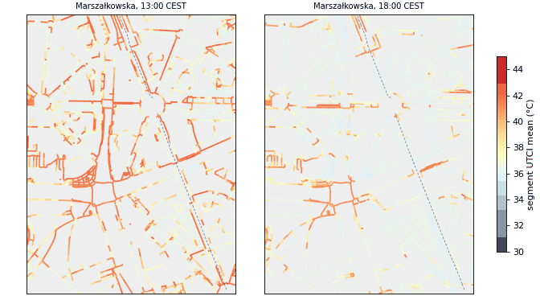
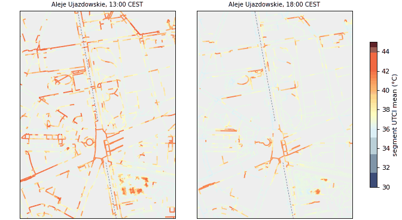
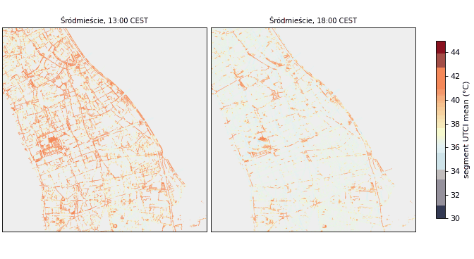

# T08 report: heat per walk segment and per stop

Brief: [tasks/T08](../../tasks/T08_segment_stop_heat.md). Code: [`heat/`](../../heat/README.md).

## What was produced

| Output | Where |
|---|---|
| Segment heat, 58,715 segments × 33 steps (1,937,595 rows) | BigQuery `hackaton-honory.warsaw_heat.t08_segment_heat`, `gs://hackaton-honory-heat/T08/t08_segment_heat.parquet` |
| Stop heat, 360 stops × 33 steps (11,880 rows) | `warsaw_heat.t08_stop_heat`, `gs://hackaton-honory-heat/T08/t08_stop_heat.parquet` |
| Run checks (source files, rule counts, coverage, cap sizes) | `gs://hackaton-honory-heat/T08/checks.json` |
| Done marker | `gs://hackaton-honory-heat/T08/_SUCCESS` |
| Stand-in (T06 tiles before T07 existed) | `warsaw_heat.t08_segment_heat_stub`, `t08_stop_heat_stub`, `T08/stub/` |
| Side-of-street table | [`sides.csv`](sides.csv), figures below, [`summary.json`](summary.json) |

**Source of the final tables:** T07 `gs://hackaton-honory-heat/T07/utci.tif` (all 27 SOLWEIG tiles, masked to T03 walkable), shadow from the T06 tiles `T06/district/tiles/*/shadow.tif`. Job `t08-heat` (europe-central2), image `t08-heat:4`, finished 03:10 UTC; `_SUCCESS` written right after. The stand-in on the T06 tiles gave the same rule counts, so the router could be built on `*_stub` meanwhile.

Columns (full list in [`heat/README.md`](../../heat/README.md)): `segment_id`, `step` 0..32, `ts_utc`, `label_local`
(`'HH:MM'` CEST), `utci_mean`, `utci_p90`, `g`, `shade_share`, `exc26`/`exc32`/`exc38`/`exc46`, `n_pixels`, `rule`.
Stops: `stop_id`, `step`, `ts_utc`, `label_local`, `utci`, `g`, `exc*`, `utci_area_mean`, `shade_share`, `shelter`, `rule`.
Every segment (all components, indoor included) and every stop has a value at all 33 steps; no NULL UTCI.

## Summaries chosen, and why

- **Pixels:** a segment's pixels are its T03 footprint (`t03_segment_pixels`), minus pixels on the T01 building mask
  (see *roof pixels* below).
- **`utci_mean`:** mean over the footprint. A walker crosses the footprint lengthwise, so the mean is the expected
  value along the walk.
- **`utci_p90`:** the 90th percentile, for "how bad is the worst part". Within-segment spread is small: median
  p90 − mean is 0.1 K, 95th percentile 4.2 K (segments half in shade).
- **`g`:** pixel mean of g(U), not g(mean U). g is convex, so this keeps the dose of a half-sunny segment honest
  (at 13:00 the district mean differs by 2 %). Default weights are spec §7 (26:1, 32:1, 38:2), set by the job's
  `WEIGHTS`.
- **`exc26`, `exc32`, `exc38`, `exc46`:** pixel means of max(0, U − t). Any dose weights on these thresholds are an
  exact linear mix, g = Σ w_t·exc_t, so the router can change the weights (spec §7 open question) without rerunning T08.
- **`shade_share`:** pixel mean of 1 − SOLWEIG `shadow`. SOLWEIG shadow is 1 in sun, 0 in building shade and 0.03
  under tree crowns (transmissivity), so tree shade counts 0.97. SOLWEIG writes shadow = 1 after sunset; T08 sets
  `shade_share` = 1 when the sun is below the horizon (21:00–22:00).
- **Traversal dose:** `g × length_m / speed` (K·s), with `length_m` from `t03_walk_segments`.

## Rules for special cases

| Case | Rule | Rows (`rule`) |
|---|---|---|
| **Roof pixels** | SOLWEIG computes Tmrt on the DSM surface, so a pixel on the building mask carries the **roof-top** value (sunlit, hot), never a pedestrian value. They are dropped from every segment and stop. 8.0 % of segment pixels are on the mask. | – |
| **Covered / under a roof** | OSM `covered` segments, and segments with ≥ 50 % of their pixels on the building mask (gates, passages, arcades not tagged), 4,727 in all. Daytime: capped at the **local shade UTCI** = median UTCI of shaded open walkable pixels within 30 m. Night, or no open pixels: local median. `shade_share` = 1. | `under_roof` |
| **Indoor / underground** (`indoor = true`, 1,546 segments, no pixels) | Constant UTCI 26 °C at every step (g = 0 with the default weights), `shade_share` = 1. Same value the spec uses for an AC vehicle; underground passages are cooler than the street, and nothing better is measured. | `indoor` |
| **No valid pixels** (outside the SOLWEIG tiles, mask fringe) | Mean of graph neighbours (shared `u`/`v` node), iterated; then the step median. | `neighbour_fill`, `step_median` |
| **Night** (21:00–22:00) | Values straight from SOLWEIG (Tmrt ≈ Ta − 1 K, spec §6 known limit: no evening pavement heat). | `pixels` |
| **Stop waiting spot** | Mean of the coolest 10 % (≥ 3 px) of the stop area's open walkable pixels: a waiting person stands in the best shade of the platform (spec §8). `utci_area_mean` keeps the whole-area mean. | `best_spot` |
| **Stop shelter** (OSM `shelter=yes`, 279 of 360) | Bus shelters are too small for the LiDAR building class, so SOLWEIG does not see them. Daytime: capped at the local shade UTCI (as above). | `shelter` |
| **Stop area without values** | 30 m neighbourhood; then the coolest segment at the stop's access node. | `neighbourhood`, `access_segments` |

### Covered segments came out *sunlit*, not shaded

The brief expected arcades to be shaded because they are roof in the DSM. They are roof, but that is the problem:
**91 % of the pixels of OSM-covered segments lie on the T01 building mask**, and SOLWEIG reports the roof-top Tmrt
there. Before the rule, 65 % of covered segment-steps in daytime had `shade_share` < 0.5. After it, covered segments
have mean `shade_share` 0.99 and are on average 1.8 K (all under-roof caps; 57,176 segment-steps) cooler than the raw roof values on average.

The same affects ordinary segments that touch buildings: 20 % of non-covered segments have at least one roof pixel
(footprint buffers that reach a wall, overhangs), 6 % are mostly roof. Dropping roof pixels and capping mostly-roof
segments handles both.

## Shady vs sunny sides: Marszałkowska and Aleje Ujazdowskie

Sidewalk-like segments (`sidewalk`, `footway`, `street_side`, `pedestrian`, `path`, `shared_street`; not crossings,
not indoor) within 30 m of the OSM centreline and parallel to it (< ~32°), split by side. Both streets run roughly
north–south. Length-weighted means:

| Street | Time | UTCI west | UTCI east | east − west (K) | shade west | shade east | g west | g east |
|---|---|---|---|---|---|---|---|---|
| Marszałkowska | 09:00 | 32.3 | 29.4 | -2.9 | 0.38 | 0.86 | 7.9 | 3.8 |
| Marszałkowska | 13:00 | 39.2 | 40.0 | +0.8 | 0.47 | 0.35 | 24.3 | 27.0 |
| Marszałkowska | 18:00 | 37.3 | 38.0 | +0.7 | 0.77 | 0.68 | 18.0 | 20.1 |
| Aleje Ujazdowskie | 09:00 | 31.5 | 29.6 | -1.8 | 0.56 | 0.87 | 6.6 | 3.9 |
| Aleje Ujazdowskie | 13:00 | 38.6 | 39.1 | +0.5 | 0.61 | 0.50 | 22.1 | 23.9 |
| Aleje Ujazdowskie | 18:00 | 36.3 | 37.4 | +1.0 | 0.96 | 0.81 | 14.9 | 17.9 |

Segments used: Marszałkowska 369 west / 228 east (5.2 / 3.4 km), Aleje Ujazdowskie 87 west / 137 east (1.5 / 2.2 km).

What is expected, and what comes out:
- **Morning (09:00, sun in the east-south-east):** east-side buildings shade their own sidewalk, so the **east side
  is cooler**: Marszałkowska east 29.4 °C vs west 32.3 °C (shade 0.86 vs 0.38), Aleje Ujazdowskie 29.6 vs 31.5 °C. Dose rate g is about half on the east side.
- **Midday (13:00, sun in the south):** a north–south street gets sun on both sides; differences are small, with the
  west side slightly cooler (Marszałkowska runs NNW–SSE, so its west side gets some shade from the south-west
  frontage).
- **Evening (18:00, sun in the west):** west-side buildings shade the west sidewalk, so the **west side is cooler**:
  Marszałkowska west 37.3 °C vs east 38.0 °C (shade 0.77 vs 0.68), Aleje Ujazdowskie 36.3 vs 37.4 °C (shade 0.96 vs 0.81), g 15–17 % lower on the west side.
- Aleje Ujazdowskie has tree rows on both sides, so shade shares are high there all day; the side contrast comes
  from the frontage and the park edge.

Segment UTCI around Marszałkowska (Pl. Zbawiciela – Pl. Konstytucji, dashed = centreline) and Aleje Ujazdowskie, 13:00
and 18:00:

## Stops

- **All 360 stops** have a waiting spot inside their area with valid UTCI at all 33 steps (`best_spot` or `shelter`;
  no neighbourhood or access-segment fallback was needed on the final field).
- **Best spot vs whole area:** at 13:00 the waiting spot is 4.5 K cooler than the area mean (median over stops; mean
  3.3 K). Waiting areas are small (3 × 15–30 m rectangles where no platform is mapped), so the best spot is usually a
  patch of tree or building shade at one end.
- **Shelters:** at 13:00, 170 of 279 sheltered stops are capped by the shelter rule (their best spot is still sunlit);
  the cap lowers UTCI by 4.0 K on average over all capped stop-steps. Sheltered stops at 13:00: 36.4 °C; stops whose best
  spot is natural shade: 37.5 °C.
- **District numbers at 13:00:** outdoor segments 39.0 °C mean (10–90 %: 36.3–41.9 °C), shade share 0.51; stop waiting
  spots 37.1 °C.

## Open issues

- **Shelter value is an estimate:** a shelter is credited with the local shade UTCI. Glass-roofed shelters let
  part of the sun through and trap heat; that is not modelled.
- **Indoor = 26 °C** is a convention, not a measurement.
- **Mostly-roof rule** (≥ 50 % of pixels on the building mask) can also catch a sidewalk whose footprint buffer
  overlaps a building wall; it is then credited with local shade. The roof test uses the 2025 LiDAR building mask.
- **Night steps** are a lower bound (spec §6: SOLWEIG has no evening pavement heat release).
- **Shadow** is SOLWEIG's own (same source as UTCI); far evening shadows of towers beyond the tile halos are missing
  (T07 check), so the late-evening sunny side is slightly over-heated where such a tower stands.
