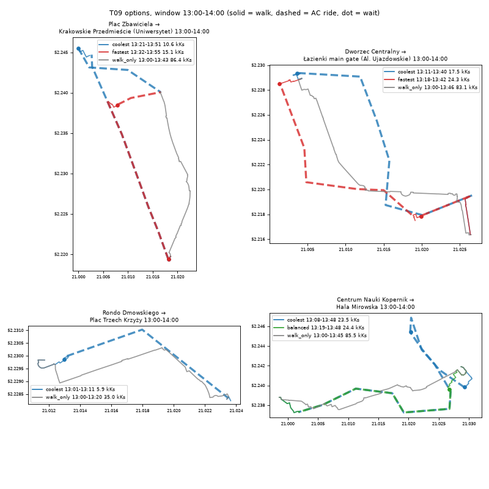
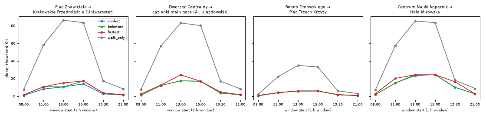

# T09: heat-aware router

**Status (2026-10-18, overnight):** router works end to end on T03 (walk network, stops) + T04 (recorded AC stop events).
The numbers below use **`HEAT_SOURCE=placeholder`**: a made-up heat field (air temperature from T05 plus a fake
radiant load by segment flags), not SOLWEIG. They show that the search, timing and pricing work; they are not
results about Warsaw's heat. Switching to T08 is one env var (`HEAT_SOURCE=stub` / `final`); rerun
`python -m router.examples` to refresh this report once `gs://hackaton-honory-heat/T08/_SUCCESS` exists.

## What was produced

| Output | Where |
|---|---|
| Python package `router/` (`plan`, `price_path`, HTTP wrapper `router.api:app`) | repo [`router/`](../../router/README.md) |
| Router data bundle (network, stops, AC stop events, line margins, forcing; 6 MB) | `gs://hackaton-honory-heat/T09/bundle/` (built by `python -m router.build_bundle`) |
| Test-pair answers, 4 pairs × 8 windows × 4 options | [`examples.csv`](examples.csv) |
| Full sample answer (contract shape, Plac Zbawiciela → Uniwersytet, 13:00–14:00) | [`examples/plan_sample.json`](examples/plan_sample.json) |
| Container image (reference deployment; T10 vendors the package) | `europe-central2-docker.pkg.dev/hackaton-honory/hackathon/t09-router:latest` |
| Reference HTTP service (Cloud Run `t09-router`, europe-central2, public, `HEAT_SOURCE=placeholder`) | https://t09-router-269831067246.europe-central2.run.app/api/health |

Contract (shared with T10/T11):

```python
from router import plan, price_path
plan(origin, destination, earliest, latest, weights=None, segment_heat=None, stop_heat=None) -> dict
price_path(coords_lonlat, depart, weights=None) -> option dict with kind "external"
```

`origin`/`destination` are `(lon, lat)`; times `'HH:MM'` local on 2026-06-28. Each option has `kind`, `depart`,
`arrive`, `duration_min`, `dose_Ks`, `peak_utci`, `minutes_per_category`, `shade_share`, `legs` (walk / wait / ride,
with times, dose, line, run_id, stops and GeoJSON in EPSG:4326) and a `MultiLineString` geometry. Extras: `walk_min`,
`walk_m`, `n_rides`, `n_transfers`, `same_as` (when two kinds pick the same trip), `search_cost`.
`weights` = list of `[threshold, weight]` pairs (default spec §7: `[[26,1],[32,1],[38,2]]`); with custom weights g is
recomputed from the mean UTCI of each segment / stop. `segment_heat` / `stop_heat` take DataFrames with the T08 columns
(used by T11 for the building-only-shade baseline). HTTP: `POST /api/plan`, `POST /api/price`, `GET /api/health`.

## Method

**Network and timing.** Main component of the T03 network (48,603 nodes, 58,242 segments; parallel edges between the
same two nodes reduced to the quickest). Walking 1.0 m/s; steps take twice as long; each segment flagged
`crossing_signals` adds 20 s of standing (charged at that segment's dose rate). Origin and destination snap to the
nearest node; the snap distance is walked at 1 m/s and charged at the first/last segment's rate.

**Transit.** Stop events of 2026-10-17 (T04), runs with `ac_boardable = TRUE` only, boarding and alighting only at
stops with `in_aoi_strict` (inside the PRG polygon). Clock time maps onto clock time (both days are CEST).
The traveller reaches the pole `margin` before the recorded departure: `margin = clip(60 s + max(0, −p05), 60, 240) s`
from `reports/T04/line_delays.csv` (median line: 103 s; lines without a record: 120 s). The margin is spent waiting
at the stop and charged at the stop's T08 value; transfers use the same margin for the connecting run.
At most one transfer, transfer walk ≤ 400 s, transfer wait ≤ 20 min. Riding counts as UTCI 26, dose 0.

**Options = one scalar objective each.** `cost = dose + λ · duration`, duration from leaving home to arrival
(waiting at home before departure is free and not counted):

| Option | λ (K, i.e. K·s of dose per second of time) | Reading |
|---|---|---|
| coolest | 0.3 | lowest dose; λ only breaks ties against absurd detours |
| balanced | 10 | one extra minute is worth it if it saves ≥ 600 K·s, i.e. one minute of walking at UTCI ≈ 34 |
| fastest | 100 | shortest trip; dose matters only between near-equal durations |
| walk_only | – | quickest walking path, departure in the window with the lowest dose (baseline) |

**Search** (all within the window `earliest`–`latest`):
1. One Dijkstra per 30-min step from the origin and from the destination (network is undirected) with edge weight
   `t_e · (g_e(step) + λ)` for coolest and balanced, plus one time-only Dijkstra (fastest, walk_only).
   ~4 ms each with `scipy.sparse.csgraph`; path time and dose to every node by pointer doubling over the
   predecessor tree. An access walk is priced on the tree of the step nearest to its start, an egress walk on the
   step of the alighting time.
2. Boarding potential per stop event: `Head = access cost + wait dose + λ·margin − λ·departure`. One running
   minimum along each run (`numpy.minimum.accumulate` with per-run offsets) gives the best boarding for every
   later alighting, so every (board, alight) pair of every run is covered in O(events).
3. One transfer: each alighting is joined to transfer walks to nearby poles and to the next 12 departures there;
   the best arrival per connecting departure becomes the new boarding potential, then step 2 again.
4. Walk-only paths per step and departure grid (5 min) as candidates too.
5. The best candidate of each type (walk / direct / one transfer) of each family is **re-priced exactly**: each
   segment at the time the traveller enters it, g interpolated linearly between steps, waits at the stop's
   interpolated value. The option is then chosen on the exact numbers, so coolest ≤ balanced ≤ fastest in dose
   always holds among the returned options.

Heat sources (`HEAT_SOURCE`): `placeholder` (built in), `stub` (`gs://…/T08/stub/t08_*.parquet`, else
`warsaw_heat.t08_*_stub`), `final` (`gs://…/T08/t08_*.parquet`, else `warsaw_heat.t08_*`). Segments missing from
T08 get the step median (outdoor) or UTCI 24 / dose 0 (indoor, underground passages); stops missing get the step
median of stops; a note in the answer says how many.

## Runtime

Laptop, bundle on local disk: load 0.3 s (from `gs://` add the 6 MB download), **median 0.24 s per query** for a
1-hour window, **1.1–1.5 s for an 8-hour window** (10:00–18:00), 2.6 s for the whole day 06:00–22:00. Time grows
with the number of 30-min steps in the window (two Dijkstras per step per end). `price_path` on a 2.5 km ORS-like
line: 0.04 s. Cloud Run (2 vCPU): cold start ~8 s (bundle download), then 0.7 s for a 1-hour window.

## Test pairs (placeholder heat)

Window 13:00–14:00 (full table for 8 windows in [`examples.csv`](examples.csv)):

| Pair | Option | Depart–arrive | Min | Dose K·s | Lines |
|---|---|---|---|---|---|
| Plac Zbawiciela → Uniwersytet | coolest = balanced | 13:21–13:51 | 30.6 | 10,572 | 4 + 111 |
| | fastest | 13:32–13:55 | 23.7 | 15,128 | 16 + 106 |
| | walk_only | 13:00–13:43 | 43.8 | 86,432 | – |
| Dworzec Centralny → Łazienki gate | coolest = balanced | 13:11–13:40 | 28.4 | 17,452 | 520 |
| | fastest | 13:18–13:42 | 24.2 | 24,250 | 11 + 523 |
| | walk_only | 13:00–13:46 | 46.7 | 83,137 | – |
| Rondo Dmowskiego → Pl. Trzech Krzyży | all three | 13:01–13:11 | 9.8 | 5,919 | 517 |
| | walk_only | 13:00–13:20 | 20.3 | 34,955 | – |
| Centrum Nauki Kopernik → Hala Mirowska | coolest | 13:08–13:48 | 40.1 | 23,518 | 118 + 106 |
| | balanced = fastest | 13:19–13:48 | 28.9 | 24,374 | 106 |
| | walk_only | 13:00–13:45 | 45.9 | 85,470 | – |

**Coolest vs fastest.** On Plac Zbawiciela → Uniwersytet (13:00–14:00) the coolest trip has **30 % less dose than
the fastest (10.6 vs 15.1 thousand K·s) and costs 7 minutes more** (30.6 vs 23.7 min): it rides tram 4 to
Plac Bankowy and bus 111, walking 6 min mostly on shaded segments (shade share 0.66 vs 0.14). On Dworzec Centralny →
Łazienki the coolest (one bus, 520) saves 28 % dose for 4 extra minutes. With an 8-hour window the router also
moves the trip in time: Dworzec Centralny → Łazienki, 10:00–18:00, coolest leaves at 10:05 (7.5 thousand K·s),
fastest at 11:15 (12.7). All AC options cut the walk-only dose by 70–90 % at midday under the placeholder field;
with the SOLWEIG field the walking share and the gaps will differ.





## What was learned

- Recorded stop events make a usable timetable: 55,675 boardable (AC) events, 950 non-AC (lines 7 and 28 mostly);
  0 or 1 transfer covers every Śródmieście pair tried.
- The scalarised search with one running minimum per run is fast enough that the departure-time search costs
  almost nothing; the 33 per-step Dijkstras dominate.
- Selection on approximate costs (step-wise walking trees) followed by exact re-pricing was necessary: before the
  exact re-ranking, coolest occasionally came out a few % above balanced.
- `fastest` with a huge λ (1000) picked trips 12 s faster at double the dose in the hottest hour; λ = 100 avoids
  that while still always preferring the shorter trip by more than a few seconds.

## Open issues

- **Placeholder heat.** Every number above. Rerun on `HEAT_SOURCE=final` when T08 lands.
- **Approximation in the search:** walk legs are chosen on the tree of one 30-min step; only the final options are
  priced with time interpolation. Coolest is the best of the candidates found, not a proven optimum.
- **Signalised crossings** split into two ≤ 25 m segments count two waits (wide avenues with islands); 20 s is a guess.
- **Snapping:** origin/destination snap to the nearest node, which can be on a synthetic sidewalk on the wrong side
  of the street; the snap stretch is walked straight.
- **Ride geometry** is the straight line between consecutive recorded stops, not the route shape.
- **Feed gap 21:53–22:07:** runs missing from the record; answers touching it carry a note.
- **One transfer max**, transfer walk ≤ 400 s, transfer wait ≤ 20 min; boarding/alighting outside Śródmieście not
  allowed (spec), so some fast trips via border stops are not offered.
- `price_path` on coarse lines (few vertices across blocks) zig-zags between sidewalks; it is meant for ORS lines
  that follow streets (2.5 km ORS-like line: +0.2 min vs the network path it was drawn from).
- With custom `weights`, g is recomputed from the segment's mean UTCI, not from its pixel distribution (T08's g
  for default weights may be the pixel mean of g).
