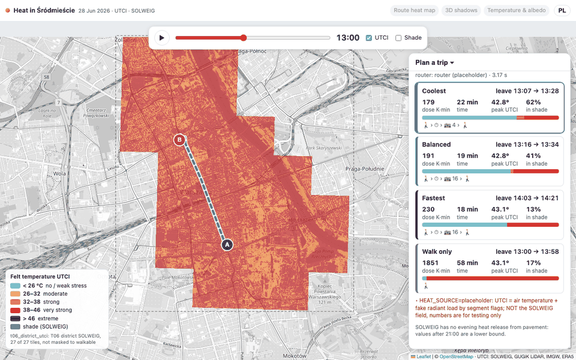
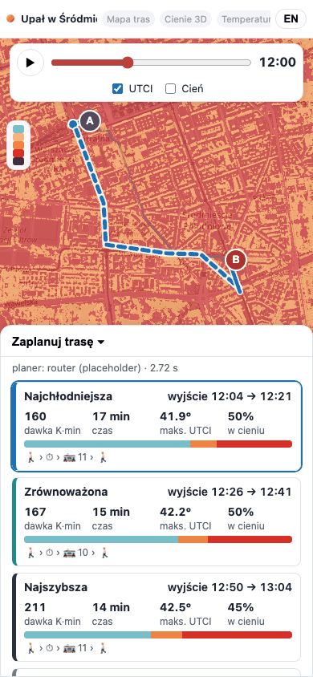
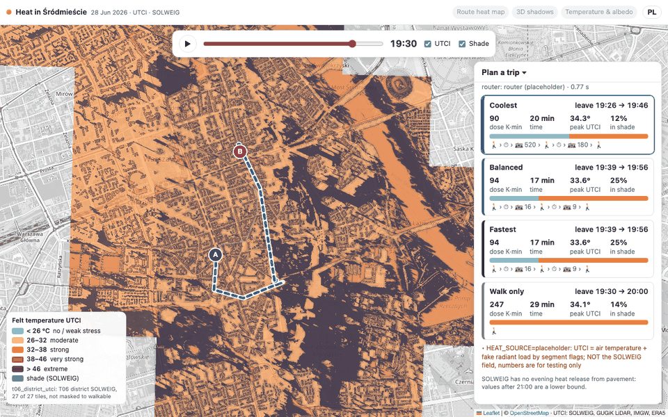

# T10 report: heat-app (time-slider map + trip planner)

**Live:** https://heat-app-269831067246.europe-central2.run.app (Cloud Run `heat-app`, europe-central2, public, no
accounts). Code: [`app/`](../../app/README.md) (build, deploy and frame-render instructions are there).

| Output | Where |
|---|---|
| Web app (FastAPI + Leaflet, PL/EN) | Cloud Run service `heat-app`, image `europe-central2-docker.pkg.dev/hackaton-honory/hackathon/heat-app:latest` |
| Frame renderer (any 33-band raster → EPSG:3857 XYZ PNG) | `app/render/render_frames.py`, image `…/hackathon/t10-render:latest`, Cloud Run Jobs `t10-render-*` (europe-central2) |
| Map frames | `gs://hackaton-honory-heat/T10/frames/<source>/<step>/<z>/<x>/<y>.png` + `<source>/meta.json` |
| Screenshots | this folder |

Frame sources rendered:

| source | input | what it is |
|---|---|---|
| `pilot_utci`, `pilot_shadow` | `T06/cog/{utci,shadow}_solweig.tif` | T06 pilot, 1.2 × 0.8 km |
| `t06_district_utci`, `t06_district_shadow` | `T06/district/tiles/*/{utci,shadow}.tif` | T06 district SOLWEIG tiles, all 27 (re-rendered 02:31 UTC once T06 finished); not masked to walkable space. 1,165 tiles per step, 38,445 in all |

The app currently shows **`t06_district_utci` + `t06_district_shadow`** (point queries read `T06/district/tiles/{e}_{n}/`). When T07 lands, integration renders `t07_utci` (and the shade from T07's
`sun_solweig.tif`, which the renderer reads too: uint8 × 250, 255 = nodata) and redeploys with `UTCI_FRAMES=t07_utci`;
the commands are in `app/README.md`.

## What the app does

- **Map:** UTCI over Śródmieście for the 33 steps of 2026-06-28 (06:00–22:00 CEST). Slider + play button (0.9 s per
  step). Colours on the UTCI stress categories with hard steps at **26 / 32 / 38 / 46 °C** and a lightness ramp inside
  each category; legend in PL/EN. **Shade toggle** overlays SOLWEIG's shadow (dark blue, alpha ∝ shade; 0.03
  transmissivity under trees reads as ~97 % shade). Grey OSM basemap so the heat colours carry the picture.
- **Click anywhere** (when not picking points): UTCI at that pixel through the day as a sparkline with the category
  lines, the current step marked, and shaded steps ticked (`/api/point`, reads the 33-band COG/tiles directly).
- **Planner:** pick A and B on the map (or one of four example trips), leave-no-earlier / arrive-no-later times,
  *Plan*. Option cards — *coolest*, *balanced*, *fastest*, *walk only* — show departure → arrival, **dose (K·min)**,
  total time, peak UTCI, share of walking in shade, and a bar of **minutes per UTCI category**; legs as 🚶 › ⏱ › 🚋 line.
  Routes are drawn on the map (selected option bold with a white casing, rides dashed, waits as dots, tooltips with
  times and leg dose); clicking a card or a line selects it and **moves the time slider to that option's departure**,
  so the shade at departure time is what you see.
- **Router:** the T09 package (`router/`) is vendored into the image and imported at startup (bundle + heat loaded
  once, ~2 s); `HEAT_SOURCE=placeholder` now. Answers in **~0.5 s** server time (~1.2 s round trip). If `router/` fails to
  import, the app falls back to `app/server/stub_router.py` (contract-shaped fake options) and says so in the notes.
  `POST /api/price` exposes `price_path()` for T11 (ORS lines).
- **T13 slots:** header chips *Route heat map / 3D shadows / Temperature & albedo* link to `HEAT_VIEWS_URL` +
  `/routes`, `/shadows3d`, `/temperature`; greyed until the URL is set at integration.
- **Phone (390 px):** header, slider and toggles fit; the planner is a bottom sheet (collapsed at load, opens after
  picking B or planning); legend shrinks to ranges only. Checked at a true 390 px viewport (`/static/phone.html`
  wraps the app in a 390 px iframe — desktop Chrome will not make a window that narrow).
- **Deep links:** `?lang=en&step=14&o=lon,lat&d=lon,lat&e=13:00&l=15:00&go=1` plans on load (used for the
  screenshots; handy for the demo script). `utci=` / `shade=` pick another frame source.
- The SOLWEIG limit (no evening heat release from pavement; values after 21:00 are a lower bound) is stated under the
  planner in both languages, and the slider label at 21:00–22:00 has a "night" tooltip.

Evening (19:30, shade on): long shadows, coolest option rides two trams to stay out of the low sun.

## Decisions

- **Pre-rendered XYZ tiles, not dynamic COG serving.** 72 Mpx × 33 steps in EPSG:2180 would need a tiler doing a
  reprojection per request; pre-rendering costs ~10 s per step per task and makes the slider instant. Zoom 12–17
  (z17 ≈ 0.73 m on the ground here, i.e. full 1 m detail), lower zooms from 2× NaN-aware averaging of the values
  (not the colours). Palette PNGs with a transparency table: ~20 kB per tile; empty tiles are not written.
- **Frames are proxied through the app** (`/frames/...` → GCS with a 256 MiB LRU cache) rather than making the bucket
  public. The bucket stays private; tiles are cached by browsers for an hour.
- **Render job split by time step** across Cloud Run tasks (`CLOUD_RUN_TASK_INDEX`); inputs are downloaded whole
  (GDAL `/vsigs/` auth is unreliable on Cloud Run) and mosaicked in memory, so the same script takes the pilot COG, a
  glob of T06 tiles or the T07 COG.
- **Night shade:** SOLWEIG writes `shadow = 1` everywhere after sunset; such steps are treated as night and get no
  shade tiles (T07's 255 = nodata is handled the same way).
- **Dose shown in K·min** (dose_Ks / 60) so the numbers are readable (e.g. 179 vs 1 851 for walk-only).
- **Point queries** sign GDAL `/vsicurl/` requests with the service account's token, so they work on Cloud Run and
  read one pixel of all 33 bands (~0.2 s).
- **Example trips** are placeholders (pl. Zbawiciela → pl. Bankowy 13–15, Dw. Centralny → pl. Zbawiciela 12–14,
  Hala Mirowska → Park Ujazdowski 15–17, pl. Konstytucji → Nowy Świat 18:30–20) until T11 fixes the demo set; they
  live in `PRESETS` in `app/server/static/app.js`.
- **Basemap:** OSM standard tiles, grey-filtered. CARTO's free basemaps now answer "API KEY REQUIRED".
- `min-instances 1` so the router bundle is warm for the demo; `/healthz` is reserved by Cloud Run, so health is
  `/api/health`.

## Learned

- **District median UTCI (T06 field, all ground pixels) peaks at 43.5 °C at 15:30**; it crosses 26 °C at 08:00, 32 °C
  at 09:00 (the jump 29.2 → 35.2 °C between 09:00 and 09:30 is the sun clearing the street canyons) and 38 °C at
  11:00, and stays above 32 °C until 20:30. At 22:00 it is still 28 °C (and a lower bound).
- **Region quota is shared between jobs and services.** With two render jobs holding 40 GiB in europe-central2, a
  heat-app revision failed to start ("Quota exceeded for total allowable memory per project per region"); the old
  revision kept serving. heat-app now runs at 2 GiB × max 3 instances. During the demo, keep heavy jobs out of
  europe-central2.

- At 13:00 almost every sunlit pixel of the district is in *very strong* stress (38–46 °C) and almost every shaded
  pixel in *strong* (32–38 °C): the map is a two-colour picture whose pattern is the shade. The lightness ramp inside
  each category keeps some detail; a continuous ramp would hide the category edges the brief asks for.
- The T06 district field still covers water and roofs-adjacent non-walkable ground (e.g. the Vistula at 09:00 shows as
  open sun); T07's walkable mask will clean this.
- Rendering while the T06 tiles were still arriving gives tasks different tile sets (a tile with shade but no UTCI
  shows as a blue square): render from a finished input set.

## Open issues

1. **Map shows the T06 district tiles, not T07** (T07 not finished by 03:30). Rerun the render on T07 and redeploy
   (`app/README.md` → *Rerun on T07*).
2. **Router runs on `HEAT_SOURCE=placeholder`** (fake heat): numbers on the cards are not the SOLWEIG field yet. Switch
   to `final` with `--update-env-vars HEAT_SOURCE=final` once T08 writes `_SUCCESS`; nothing else changes.
3. **T08 hover details** (segment UTCI per step on hover) are not in the app; the click time series from the raster
   covers the "what is it like here" question.
4. **Demo trips** are placeholders until T11; **T13 links** are greyed until `HEAT_VIEWS_URL` is set.
5. No offline/low-bandwidth mode: each slider step loads ~10–30 tiles (~0.3–0.6 MB) at street zoom.
