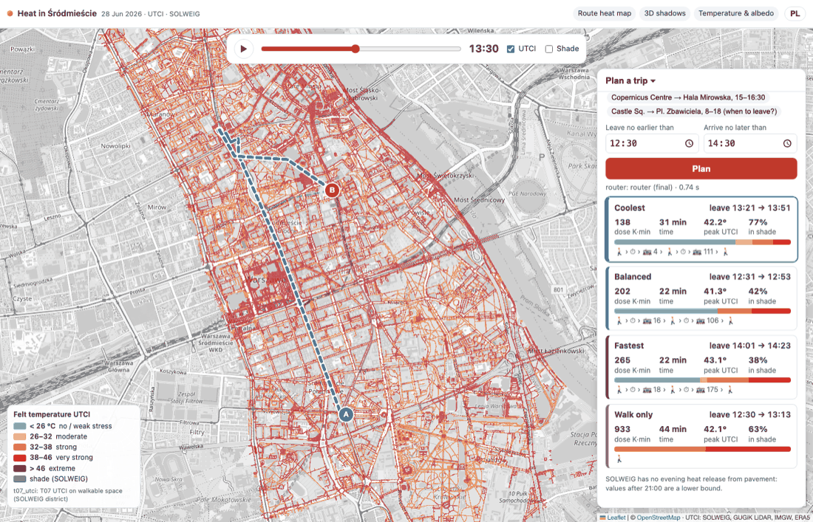
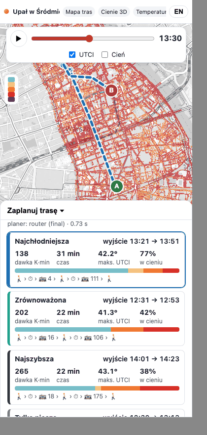
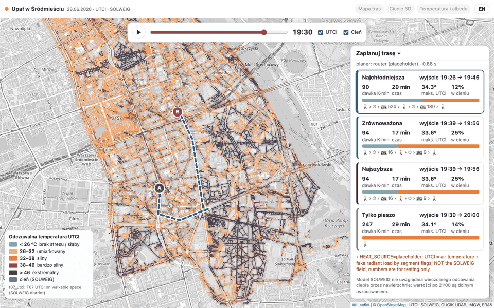

# T10 report: heat-app (time-slider map + trip planner)

**Live:** https://heat-app-269831067246.europe-central2.run.app (Cloud Run `heat-app`, europe-central2, public, no
accounts).

**Status (2026-10-18 03:35 UTC, integration):** map on the T07 field, router on **T08 final**
(`HEAT_SOURCE=final`, revision `heat-app-00016`, image `heat-app:int3` = `:latest`, 2 vCPU / 4 GiB, min 1 instance,
CPU always allocated),
T13 links live. The five T11 demo trips plan in 0.6–0.9 s round trip (3.8 s for the 10-hour window); see
[On the final field](#on-the-final-field). Code: [`app/`](../../app/README.md) (build, deploy and frame-render instructions are there).

| Output | Where |
|---|---|
| Web app (FastAPI + Leaflet, PL/EN) | Cloud Run service `heat-app`, image `europe-central2-docker.pkg.dev/hackaton-honory/hackathon/heat-app:latest` |
| Frame renderer (any 33-band raster → EPSG:3857 XYZ PNG) | `app/render/render_frames.py`, image `…/hackathon/t10-render:latest`, Cloud Run Jobs `t10-render-*` (europe-central2) |
| Map frames | `gs://hackaton-honory-heat/T10/frames/<source>/<step>/<z>/<x>/<y>.png` + `<source>/meta.json` |
| Screenshots | this folder |

Frame sources rendered:

| source | input | what it is |
|---|---|---|
| `pilot_utci`, `pilot_shadow` | `T06/cog/{utci,shadow}_solweig.tif` | T06 pilot, 1.2 × 0.8 km |
| `t06_district_utci`, `t06_district_shadow` | `T06/district/tiles/*/{utci,shadow}.tif` | T06 district SOLWEIG tiles, all 27; not masked to walkable space. 1,165 tiles per step, 38,445 in all |
| **`t07_utci`, `t07_shade`** (live) | `T07/utci.tif`, `T07/sun_solweig.tif` | **T07 final field** (`_SUCCESS` 02:46 UTC), walkable pixels only. 24,090 + 21,900 tiles; shade has no tiles at 21:00–22:00 (sun down) |

The app shows **`t07_utci` + `t07_shade`**, and point queries read `T07/utci.tif` and `T07/sun_solweig.tif`. T07
finished at 02:46 UTC, rendering took 6 min, and the app was switched at 02:53 UTC. If T07 is rerun, rerun the jobs `t10-render-t07-utci` and `t10-render-t07-shade`. They are already deployed with the
right inputs: `gcloud run jobs execute t10-render-t07-utci --region europe-central2`. The commands are in `app/README.md`.

Plac Zbawiciela → Uniwersytet, 12:30–14:30, router on T08 final, map at 13:30.

## What the app does

- **Map:** UTCI over Śródmieście for the 33 steps of 2026-06-28 (06:00–22:00 CEST). Slider + play button (0.9 s per
  step). Colours on the UTCI stress categories with hard steps at **26 / 32 / 38 / 46 °C** and a lightness ramp inside
  each category; legend in PL/EN. **Shade toggle** overlays SOLWEIG's shadow (dark blue, alpha ∝ shade; 0.03
  transmissivity under trees reads as ~97 % shade). Grey OSM basemap so the heat colours carry the picture.
- **Click anywhere** (when not picking points): UTCI at the nearest walkable pixel (within 15 m; the snap distance is
  shown) through the day as a sparkline with the category
  lines, the current step marked, and shaded steps ticked (`/api/point`, reads the 33-band COG/tiles directly).
- **Planner:** pick A and B on the map (or one of the five T11 demo trips), leave-no-earlier / arrive-no-later times,
  *Plan*. Option cards — *coolest*, *balanced*, *fastest*, *walk only* — show departure → arrival, **dose (K·min)**,
  total time, peak UTCI, share of walking in shade, and a bar of **minutes per UTCI category**; legs as 🚶 › ⏱ › 🚋 line.
  Routes are drawn on the map (selected option bold with a white casing, rides dashed, waits as dots, tooltips with
  times and leg dose); clicking a card or a line selects it and **moves the time slider to that option's departure**,
  so the shade at departure time is what you see.
- **Router:** the T09 package (`router/`) is vendored into the image and imported at startup (bundle + heat loaded
  once, 3.8 s at start); `HEAT_SOURCE=final` (T08 `t08_*` parquet from the bucket). Answers in **~0.5 s** server time (~1.2 s round trip). If `router/` fails to
  import, the app falls back to `app/server/stub_router.py` (contract-shaped fake options) and says so in the notes.
  `POST /api/price` exposes `price_path()` for T11 (ORS lines).
- **T13 slots:** header chips *Route heat map / 3D shadows / Temperature & albedo* link to `HEAT_VIEWS_URL` +
  `/routes/`, `/shadows3d/`, `/temperature/` (`HEAT_VIEWS_URL=https://heat-views-269831067246.europe-central2.run.app`).
- **Phone (390 px):** header, slider and toggles fit; the planner is a bottom sheet (collapsed at load, opens after
  picking B or planning); legend shrinks to ranges only. Checked at a true 390 px viewport (`/static/phone.html`
  wraps the app in a 390 px iframe — desktop Chrome will not make a window that narrow).
- **Deep links:** `?lang=en&step=14&o=lon,lat&d=lon,lat&e=13:00&l=15:00&go=1` plans on load (used for the
  screenshots; handy for the demo script). `utci=` / `shade=` pick another frame source.
- The SOLWEIG limit (no evening heat release from pavement; values after 21:00 are a lower bound) is stated under the
  planner in both languages, and the slider label at 21:00–22:00 has a "night" tooltip.

Evening (19:30, T07 field with shade on): long shadows over the walkable network. The coolest option uses two buses.

## On the final field

Integration smoke test, 2026-10-18 03:30 UTC, `POST /api/plan` on the live service (router `final`, no notes) for
the five T11 demo trips. Dose with spec §7 weights; "less" = coolest vs fastest.

| Trip, window (CEST) | Coolest | Fastest | Walk only | Coolest vs fastest | Round trip |
|---|---|---|---|---|---|
| Plac Zbawiciela → Uniwersytet (Krakowskie Przedmieście), 12:30–14:30 | 13:21–13:51, 30.6 min, 8,283 K·s (4+111) | 14:01–14:23, 21.7 min, 15,916 K·s (18+175) | 43.8 min, 55,983 K·s | 48 % less, +8.9 min | 0.8 s |
| Dworzec Centralny → Łazienki main gate (Al. Ujazdowskie), 14:00–15:30 | 14:16–14:44, 27.3 min, 13,696 K·s (520) | 14:39–15:03, 24.0 min, 14,358 K·s (525) | 46.7 min, 68,279 K·s | 5 % less, +3.3 min | 0.9 s |
| Rondo Dmowskiego → Plac Trzech Krzyży, 18:30–20:00 | 19:42–19:51, 8.9 min, 2,326 K·s (517) | 19:42–19:51, 8.9 min, 2,326 K·s (517) | 20.3 min, 9,534 K·s | 0 % less, +0.0 min | 0.6 s |
| Centrum Nauki Kopernik → Hala Mirowska, 15:00–16:30 | 15:36–16:13, 37.1 min, 16,725 K·s (118+106) | 16:00–16:27, 27.2 min, 24,818 K·s (106) | 45.9 min, 75,869 K·s | 33 % less, +9.9 min | 0.6 s |
| Plac Zamkowy → Plac Zbawiciela (whole day window), 08:00–18:00 | 08:08–08:30, 21.5 min, 1,294 K·s (4) | 10:17–10:34, 17.6 min, 9,874 K·s (13+16) | 58.6 min, 16,506 K·s | 87 % less, +3.9 min | 3.8 s |

- **Headline:** Plac Zbawiciela → Uniwersytet at midday: the coolest trip (tram 4 + bus 111, leave 13:21) takes
  **48 % less heat dose than the fastest** (8.3 vs 15.9 thousand K·s) for **8.9 more minutes**, and **85 % less than
  walking** the whole way (56.0 thousand K·s, 44 min).
- **When to leave:** with the 08:00–18:00 window on Plac Zamkowy → Plac Zbawiciela the coolest trip leaves at 08:08
  (tram 4, 1.3 thousand K·s), 87 % below the fastest at 10:17, for 3.9 more minutes.
- The evening trip (Rondo Dmowskiego, 18:30–20:00) has one answer: coolest = fastest (bus 517 at 19:42).
- `POST /api/price` on a coarse 3-point line Zbawiciela → Uniwersytet: 48.0 min (walk-only plan: 43.8 min); before
  the integration fix of `price_path` the same line priced at 62.5 min (zig-zag between sidewalks).
- `/api/point`, `/frames/t07_utci/…` and the three heat-views pages answer 200.

## Decisions

- **Pre-rendered XYZ tiles, not dynamic COG serving.** 72 Mpx × 33 steps in EPSG:2180 would need a tiler doing a
  reprojection per request; pre-rendering costs ~10 s per step per task and makes the slider instant. Zoom 12–17
  (z17 ≈ 0.73 m on the ground here, i.e. full 1 m detail), lower zooms from 2× NaN-aware averaging of the values
  (not the colours). Palette PNGs with a transparency table: ~20 kB per tile; empty tiles are not written.
- **Frames are proxied through the app** (`/frames/...` → GCS with a 256 MiB LRU cache) rather than making the bucket
  public. The bucket stays private; tiles are cached by browsers for an hour.
- **Render job split by time step** across Cloud Run tasks (`CLOUD_RUN_TASK_INDEX`); inputs are downloaded whole
  (GDAL `/vsigs/` auth is unreliable on Cloud Run) and mosaicked in memory, so the same script takes the pilot COG, a
  glob of T06 tiles or the T07 COG.
- **Night shade:** SOLWEIG writes `shadow = 1` everywhere after sunset; such steps are treated as night and get no
  shade tiles (T07's 255 = nodata is handled the same way).
- **Dose shown in K·min** (dose_Ks / 60) so the numbers are readable (e.g. 179 vs 1 851 for walk-only).
- **Point queries** sign GDAL `/vsicurl/` requests with the service account's token, so they work on Cloud Run and
  read one pixel of all 33 bands (~0.2 s).
- **Example trips** are the five T11 demo trips (`demo/demo_trips.json`); they live in `PRESETS` in
  `app/server/static/app.js`.
- **Basemap:** OSM standard tiles, grey-filtered. CARTO's free basemaps now answer "API KEY REQUIRED".
- `min-instances 1` so the router bundle is warm for the demo, and `--no-cpu-throttling`: the router loads in a
  background thread after startup, and with request-only CPU that took 60–100 s instead of 3.8 s; `/healthz` is reserved by Cloud Run, so health is
  `/api/health`.

## Learned

- **Example trips (placeholder heat, so only the mechanics count):** answers take 0.8–1.1 s in the router and
  0.9–1.3 s round trip. At midday, coolest vs walk-only is 179 vs 1,851 K·min for pl. Zbawiciela → pl. Bankowy.
  These numbers are not results: the router runs on `HEAT_SOURCE=placeholder` until T08 is final.
- **District median UTCI (T06 field, all ground pixels) peaks at 43.5 °C at 15:30**; it crosses 26 °C at 08:00, 32 °C
  at 09:00 (the jump 29.2 → 35.2 °C between 09:00 and 09:30 is the sun clearing the street canyons) and 38 °C at
  11:00, and stays above 32 °C until 20:30. At 22:00 it is still 28 °C (and a lower bound).
- **Region quota is shared between jobs and services.** With two render jobs holding 40 GiB in europe-central2, a
  heat-app revision failed to start ("Quota exceeded for total allowable memory per project per region"); the old
  revision kept serving. heat-app now runs at 2 GiB × max 3 instances. During the demo, keep heavy jobs out of
  europe-central2.

- At 13:00 almost every sunlit pixel of the district is in *very strong* stress (38–46 °C) and almost every shaded
  pixel in *strong* (32–38 °C): the map is a two-colour picture whose pattern is the shade. The lightness ramp inside
  each category keeps some detail; a continuous ramp would hide the category edges the brief asks for.
- The T06 district field still covers water and roofs-adjacent non-walkable ground (e.g. the Vistula at 09:00 shows as
  open sun); T07's walkable mask will clean this.
- Rendering while the T06 tiles were still arriving gives tasks different tile sets (a tile with shade but no UTCI
  shows as a blue square): render from a finished input set.

## Open issues

1. Done: **the map is on T07.** The `t06_district_*` frames stay in the bucket as a cross-check (`?utci=t06_district_utci&shade=t06_district_shadow`).
2. Done (integration, 03:25 UTC): **router on `HEAT_SOURCE=final`.** If T08 is regenerated, redeploy (or restart)
   heat-app: heat is loaded once at startup.
3. **T08 hover details** (segment UTCI per step on hover) are not in the app; the click time series from the raster
   covers the "what is it like here" question.
4. Done: **demo trips** = T11 set, **T13 links** live.
5. No offline/low-bandwidth mode: each slider step loads ~10–30 tiles (~0.3–0.6 MB) at street zoom.
