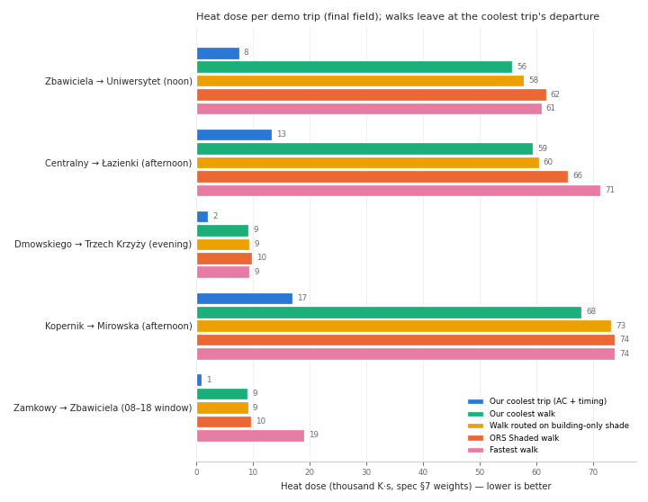
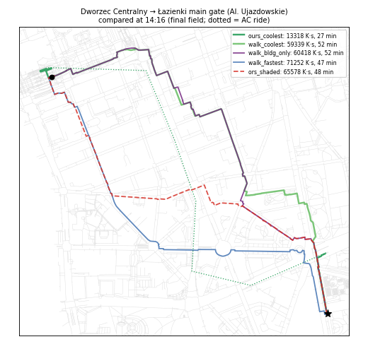
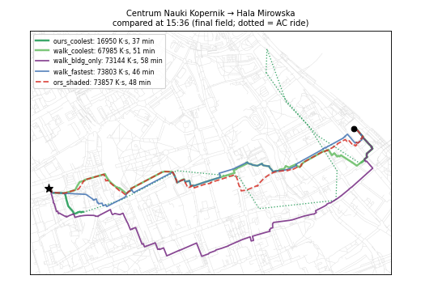
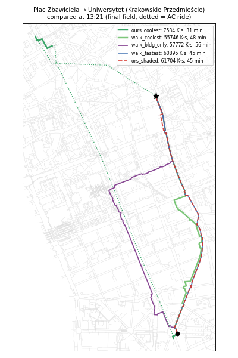
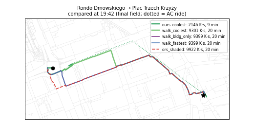
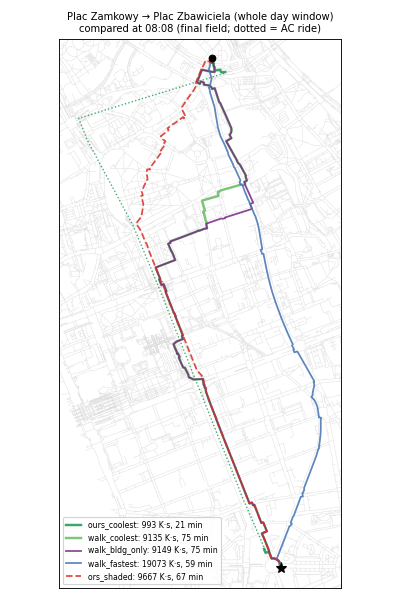

# T11 report: demo trips, baselines (ORS Shaded, building-only shade) and dose weights

**Status (2026-10-18 03:15 UTC):** final. Everything below is on the **final field**, T08 `warsaw_heat.t08_*` on the T07 SOLWEIG district run (T08 `_SUCCESS` 03:10 UTC), with the T09 router from `main`. It was produced by the one-command rerun `bash demo/run_final.sh` (see [Rerun](#rerun)). An earlier preview on the T08 stub field (`*_stub.*`) gave identical numbers on four trips and differed only on Kopernik → Mirowska (the stub was built from 21 of the 27 SOLWEIG tiles).

## What was produced and where

| Output | Where |
|---|---|
| 5 demo trips, each with a one-line reason | [`demo/demo_trips.json`](../../demo/demo_trips.json), `gs://hackaton-honory-heat/T11/demo_trips.json` |
| Building-only shade per segment and stop: `B = f_bldg + f_both`, `f_tree`, `f_sun` from T02, per step | `T11/bldg_only/segment_shade.parquet` (58,715 segments × 33), `stop_shade.parquet` (360 × 33) |
| Building-only **routing costs** with the T08 columns (`segment_id, step, ts_utc, label_local, utci_mean, utci_p90, g, shade_share`; stops `stop_id, step, ts_utc, label_local, utci, g`) | `T11/segment_heat_bldg_only.parquet`, `T11/stop_heat_bldg_only.parquet` (= last calibration; copies `*_pilot`, `*_t08_stub`) |
| T02-zone stand-in field (only for testing before T08 existed) | `T11/segment_heat_standin.parquet`, `stop_heat_standin.parquet` |
| ORS Shaded answers (25 cached) | `T11/ors_cache/<trip>__<doy>_<hour>__f<factor>.json` |
| Comparison table per trip, weight sensitivity, headline | `reports/T11/comparison_<field>.csv`, `weights_<field>.csv`, `weights_summary_<field>.csv`, `headline_<field>.md/json`; full legs in `T11/results/<field>/results_<field>.json` |
| Maps of the compared routes, summary chart | `reports/T11/map_<trip>_final.png`, `summary_final.png` |
| Code | [`demo/`](../../demo/README.md) |

`<field>` is `final` (router + T08 final), `stub` (router + T08 stub), `standin` (router + T11 stand-in), or `…_walkonly` (no router, walk-only fallback).

## Demo trips

| Trip | Window (CEST) | Why it is in the demo |
|---|---|---|
| Plac Zbawiciela → Uniwersytet | 12:30–14:30 | **Midday** peak on the 2.5 km north–south axis: Marszałkowska is sunlit at noon; tree-lined side streets and AC trams 4/15/18/35 are the alternatives |
| Dworzec Centralny → Łazienki gate | 14:00–15:30 | Afternoon heat **where trees matter most**: the double tree rows of Al. Ujazdowskie are invisible to building-only shade |
| Rondo Dmowskiego → Plac Trzech Krzyży | 18:30–20:00 | **Low-sun evening** (15° at 19:00) on the east–west Al. Jerozolimskie / Nowy Świat axis: long shadows, including far casters, decide which side is cool |
| Centrum Nauki Kopernik → Hala Mirowska | 15:00–16:30 | Longest cross-district trip against the afternoon sun: an **AC bus/tram leg** should beat any walk |
| Plac Zamkowy → Plac Zbawiciela | 08:00–18:00 | 3.3 km on the Royal Route with AC buses and a 10 h window: the planner chooses **when** to leave, not only which way |

## Method

**Candidates per trip.** Every candidate is priced on the **same field** by one pricer (`demo/engine.py`): walk at 1.0 m/s; each segment is priced at the time the traveller is on it, interpolated between the 30-min steps; 30 s of waiting at every signalised crossing; waiting at a stop at the stop's UTCI; an AC ride counts as U = 26 °C (no dose). Dose uses spec §7 weights.

| Candidate | What |
|---|---|
| `ours_coolest`, `ours_balanced`, `ours_fastest`, `ours_walk_only` | T09 `router.plan()` options, each with its own best departure |
| `bldg_only` | `router.plan(segment_heat=building-only, stop_heat=building-only)`, coolest option, re-priced on the real field |
| `walk_coolest` | Min-dose **walk** on the real field (T11 engine), the like-for-like counterpart of ORS |
| `walk_bldg_only` | Min-dose walk on building-only costs, re-priced on the real field: **what LiDAR trees add** |
| `walk_fastest` | Shortest-time walk |
| `ors_shaded` | ORS Shaded route, slot `172_<h>` for the departure, factor 0.8 (the app's default) |
| `ors_plain` | ORS unweighted route (factor 0) |
| `fastest_now` | Fastest walk leaving at the earliest time: no time choice, no transit |

`walk_*` and `ors_*` leave at `ours_coolest`'s departure, so route choice is separated from departure choice.

**Building-only costs.** The t11-bldg job averages T02's `B = f_bldg + f_both` (solid shade: buildings and terrain), `f_tree` and `f_sun` over each segment's T03 pixels and each stop area. A segment's UTCI is then a mix of per-step zone UTCIs:
- **Building-only** (what a tool without trees believes): `U = (f_sun + f_tree)·U_sun + B·U_bldg`.
- **Stand-in field:** `U = f_sun·U_sun + f_tree·U_tree + B·U_bldg`.

The zone UTCIs come from one of two sources:
- `pilot`: the SOLWEIG pilot's mean Tmrt per T02 zone and step (T06 `by_zone_time.csv`), with T05 forcing, through `pythermalcomfort`.
- `t08`: a per-step least-squares fit of T08 `utci_mean` on the segment's three shares, so the baseline lives on the same field it is priced on.

The two calibrations agree within about 1 K. At 13:00 (`zone_utci_pilot.csv` vs `zone_utci_t08_stub.csv`; the final-field fit `zone_utci_t08.csv` is within 0.5 K of the stub fit at 13:00):

| Zone | Pilot | Stub fit |
|---|---|---|
| sun | 41.8 | 41.2 |
| tree | 36.4 | 35.6 |
| building | 36.4 | 36.6 |

Stops use the best spot: the stop-area pixel with the most building shade.

## Headline (final field)

Dose saved = 1 − ours / baseline; minutes = ours − baseline.

| Trip | Coolest trip vs walking now | vs our fastest | Coolest walk vs fastest walk | Coolest walk vs ORS Shaded | Coolest walk vs building-only walk |
|---|---|---|---|---|---|
| Zbawiciela → Uniwersytet, noon | **−86 %** (−14 min) | −49 % (+9 min) | −8 % (+4 min) | −10 % (+4 min) | −4 % (−7 min) |
| Centralny → Łazienki | **−81 %** (−20 min) | −5 % (+3 min) | −17 % (+5 min) | −10 % (+5 min) | −2 % (+1 min) |
| Dmowskiego → Trzech Krzyży, evening | **−87 %** (−11 min) | 0 % | −1 % (0 min) | −6 % (0 min) | −1 % (0 min) |
| Kopernik → Mirowska | **−79 %** (−9 min) | −32 % (+10 min) | −8 % (+5 min) | −8 % (+3 min) | **−7 %** (−7 min) |
| Zamkowy → Zbawiciela, all day | **−94 %** (−38 min) | −90 % (+4 min) | −52 % (+16 min) | −6 % (+8 min) | 0 % |



- **Pitch line:** planning in space *and* time with AC trams and buses cuts the heat dose by **79–94 %** against walking at the requested time, and it is also **9–38 min faster**. Most of the gain is from the AC ride and from the departure time. Shade routing alone saves **1–17 %** at a fixed departure (52 % on the all-day trip, where the shaded early-morning route is 16 min longer).
- **ORS Shaded on our field:** our coolest walk has **6–10 % less dose** than ORS Shaded's route, at +0–8 min. On the noon trip the ORS Shaded route has *more* dose than ORS's own unweighted route on our field (61.7 vs 61.1 k K·s). Its shade layer (synthetic nDSM, 4 fixed slots on 21 June) disagrees with SOLWEIG at that hour.
- **Trees (building-only):**
  - For walking, routing on building-only shade costs **0–4 %** more dose on four trips and **7 %** on Kopernik → Mirowska, where the building-only route is 400 m longer *and* hotter.
  - For the multimodal trip, building-only routing gives the same answer as ours: the walk legs are 270–680 m and the ride dominates.
  - The tree effect is real but small where SOLWEIG's tree shade is close to building shade (U_tree ≈ U_bldg in the calibration).
- **Router behaviour worth a look (T09):** on the noon trip, `ours_coolest` rides tram 4 north past Uniwersytet, transfers, and rides bus 111 back (see map). Riding is dose-free, so this is optimal for the metric, but it looks odd in a demo. A small per-transfer or ride-time penalty would avoid it.
- **Router check:**
  - We re-priced the router's own options independently on the same field: median −2.3 %, 17 of 20 within ±8 %.
  - The worst case, −23 %, is the 991 K·s early-morning transit option of the Zamkowy trip, where small absolute differences in the wait and stop rules weigh a lot.
  - For ORS lines, `router.price_path` and our pricer agree within 3 %.

### Per-trip tables (final field)

Dose in K·s.

<details><summary>Zbawiciela → Uniwersytet (12:30–14:30)</summary>

| Candidate | Depart → arrive | Min | Walk m | Rides | Dose | Peak UTCI |
|---|---|---|---|---|---|---|
| ours_coolest | 13:21 → 13:51 | 31 | 346 | 2 | 7,584 | 42.2 |
| ours_balanced | 12:31 → 12:53 | 22 | 260 | 2 | 12,269 | 41.4 |
| ours_fastest | 14:01 → 14:23 | 22 | 414 | 2 | 14,923 | 43.1 |
| ours_walk_only | 12:30 → 13:14 | 45 | 2,509 | 0 | 56,070 | 42.1 |
| bldg_only | 13:21 → 13:51 | 31 | 346 | 2 | 7,584 | 42.2 |
| walk_coolest | 13:21 → 14:09 | 48 | 2,721 | 0 | 55,746 | 42.8 |
| walk_bldg_only | 13:21 → 14:16 | 56 | 3,094 | 0 | 57,772 | 42.9 |
| walk_fastest | 13:21 → 14:05 | 45 | 2,494 | 0 | 60,896 | 42.8 |
| ors_shaded | 13:21 → 14:06 | 45 | 2,512 | 0 | 61,704 | 42.9 |
| ors_plain | 13:21 → 14:05 | 44 | 2,492 | 0 | 61,055 | 42.8 |
| fastest_now | 12:30 → 13:14 | 45 | 2,494 | 0 | 55,730 | 42.1 |
</details>

Full tables with shade shares and minutes per UTCI category: [`comparison_final.csv`](comparison_final.csv) (preview runs: `comparison_stub.csv`, `comparison_standin.csv`).







## Dose weights (spec §7)

Five weight sets, all g(U) = Σ wₖ·max(0, U − tₖ):

| Set | Terms |
|---|---|
| `spec` | 1·(U−26) + 1·(U−32) + 2·(U−38) |
| `linear26` | 1·(U−26) |
| `strong_only` | 1·(U−32) |
| `steep` | 1·(U−26) + 2·(U−32) + 4·(U−38) |
| `very_strong_only` | 1·(U−38) |

Two questions were asked of each set:
- **Does the ranking change?** All candidates of a trip were re-scored under the set, and the ranking compared with Kendall τ.
- **Does the coolest walk change?** The coolest walk was re-planned under the set (`weights_summary_final.csv`).

| Weights | Mean τ vs spec | Trips where the best option changes | Trips where the coolest walk changes |
|---|---|---|---|
| `linear26` | 0.88 | 1 / 5 (Kopernik: `bldg_only` edges `ours_coolest`) | 4 / 5 |
| `strong_only` | 0.91 | 0 | 3 / 5 |
| `steep` | 0.98 | 0 | 1 / 5 |
| `very_strong_only` | 0.85 | 0 | 5 / 5 |

**What this says:**
- **The best option is robust.** Under every weight set our coolest option stays best on 4–5 of 5 trips; only the order of near-equal options changes.
- **Walking route choice is sensitive to the weights:**
  - Under `linear26`, on the noon and Kopernik trips the fastest walk wins (shorter exposure beats shade).
  - Threshold-only weights (`very_strong_only`, `strong_only`) make the walk router detour hard to stay below the threshold, up to +3.8 km (Centralny → Łazienki 6.8 km instead of 3.1 km; Kopernik 5.5 km instead of 2.9 km), because time spent below the threshold is free.
  - The `spec` and `steep` weights keep a baseline term from 26 °C. That term charges every minute in heat and keeps the coolest walk within +0–0.9 km of the fastest.
- **Recommendation:** keep the spec weights (or `steep`: τ = 0.98, the coolest walk changes on 1 trip of 5). Do not use threshold-only weights for an elderly persona: they reward long walks.

## Rerun

```bash
# from the repo root, with gcloud ADC or GOOGLE_APPLICATION_CREDENTIALS set, router/ present in the repo
bash demo/run_final.sh          # = bldg_only --calib t08, run_demo --heat final, headline --heat final
bash demo/run_final.sh stub     # the preview above
ROUTER_PATH=/path/to/checkout bash demo/run_final.sh   # router from another checkout
```

The building-only shares only need recomputing if T02 changes: Cloud Run Job `t11-bldg` (europe-north1, image `t11-bldg:v2`, 2 vCPU / 8 GiB). It took about a minute on a 4-vCPU VM.

## What was learned

- **ORS Shaded is usable without a key:**
  - The app calls `POST https://api.shaded.openrouteservice.org/ors/v2/directions/foot-walking/geojson` with `options.profile_params.weightings = {csv_column: "<doy>_<hour>", csv_factor: 0.8}`.
  - The 16 columns are day of year 141/172/202/233 (the 21st of May–August) × hours 9/12/15/18. The app maps June to 172 and the time of day to the nearest slot (≤11:30 → 9, ≤14:30 → 12, ≤17:30 → 15, else 18).
  - `extra_info=["csv"]` returns the per-edge value 0–100, which is **sun exposure** (the weighted route lowers it).
  - Graph: OSM 2026-09-25, engine 10.0.1.
  - 25 requests with a 2 s pause gave no errors and no rate-limit headers.
  - Shade data (prior-art notes): a synthetic 1 m nDSM from TUM buildings, CHMv2 canopy and a 30 m DEM, run through r.sunmask; no Tmrt and no validation.
- **The T02 COGs are pixel-interleaved** (33 bands per block). Reading one band at a time decompresses all 33: 47 s per band. Reading 512-row strips with all bands takes 2 s per strip, 40 s in total.
- **Cloud Run quota:** at 02:00 UTC both europe-central2 and europe-north1 refused even a 2-vCPU task ("waiting for quota capacity", the T06 and T10 jobs held them). The job ran instead on a short-lived COS VM (`t11-bldg-vm`, e2-standard-4, deleted after the run). COS needs `docker-credential-gcr` with a writable `DOCKER_CONFIG` to pull from Artifact Registry.

## Open issues

- **Reruns:** if T07/T08 or the router change, rerun `bash demo/run_final.sh`; the outputs are deterministic (two runs gave byte-identical CSVs and maps).
- **Building-only baseline is a zone model:** it changes shade *classification* only; within-zone variation (sky view, surfaces) is not modelled. A cleaner baseline is a SOLWEIG run without CDSM; out of scope tonight.
- **ORS lines are snapped** to the nearest T03 segment within 30 m every 5 m (all samples snapped). A sample can land on the other sidewalk of a narrow street.
- **Night steps** (21:00–22:00) carry SOLWEIG's missing evening heat release (spec §6); none of the demo trips runs after 20:30.
- **Walk-only coolest search** is a label-setting heuristic with time-dependent costs. The fastest path is kept when it prices lower.
- **Optional on-site photo check** of low-sun shadows: not done.
