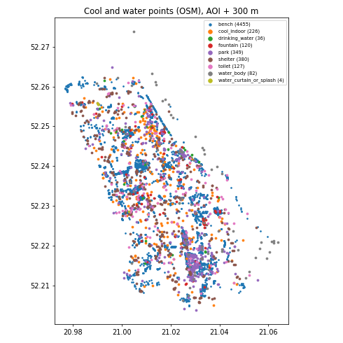
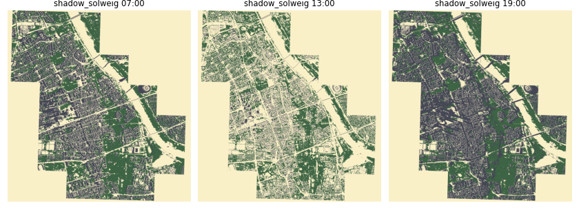
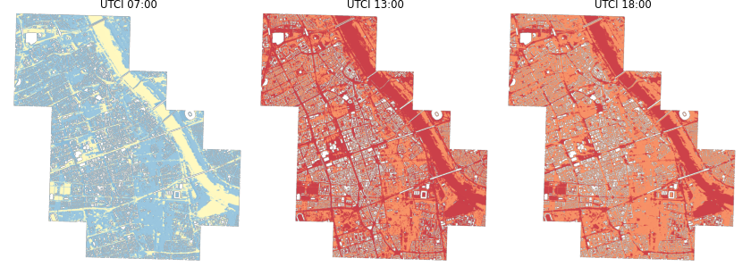
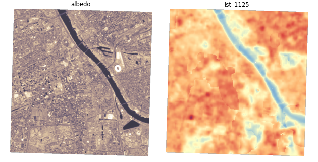
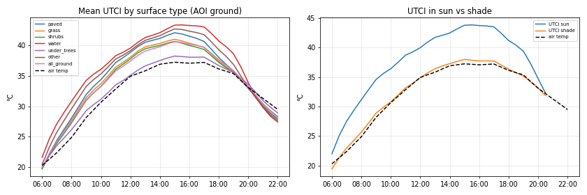

# T12 report: visual layers for the three views

Everything T13 needs is in `gs://hackaton-honory-heat/T12/`, described by **`T12/manifest.json`** (every layer, path,
format, frame corners, legend, value decoding, step meaning, captions in Polish and English). Code: `layers/`
(one image `t12-layers`, run as Cloud Run Jobs). No view needs processing: GeoJSON, PNG frames and small JSON.

**Key number:** at 15:00 the mean UTCI on sunlit ground in Śródmieście is **43.8 °C** and in shade **38.0 °C**
(air 37.2 °C); under tree crowns 38.2 °C vs 42.1 °C on paved ground. Between 13:00 and 18:00 the sunlit share of paved
ground falls from 77 % to 37 %, which is why the same street is bearable at 18:00 and not at 13:00 (`fig4`).

## What was produced

| View | Layer | Where (in `T12/`) | Format |
|---|---|---|---|
| 1 Routes + cool points | cool and water points | `points/cool_points.geojson`, `.parquet`; BigQuery `warsaw_heat.t12_cool_points` | GeoJSON points 4326, per point 33-step arrays |
| | parks, water, cool indoor buildings | `points/cool_areas.geojson` | GeoJSON polygons 4326 |
| 2 3D shadows | building blocks | `scene/buildings.geojson` | GeoJSON polygons with `h` (m above ground), `z0` |
| | trees | `scene/trees.geojson` | GeoJSON points with `h`, `base`, `r`, `z0` |
| | shadow per step (SOLWEIG) | `frames/shadow_solweig/00..32.png` | 2 m PNG, EPSG:3857 |
| | shadow per step (T02 shares) | `frames/shadow_t02/00..32.png` | 2 m PNG, EPSG:3857 |
| | sun vector, clouds | `scene/sun_cloud.json` | JSON, 33 steps |
| 3 Temperature + albedo | UTCI per step | `frames/utci/NN.png`, `frames/utci_value/NN.png` | 4 m colour + grey value PNG |
| | Tmrt per step | `frames/tmrt/NN.png`, `frames/tmrt_value/NN.png` | 4 m colour + grey value PNG |
| | albedo | `frames/albedo.png`, `rasters/albedo_10m.tif` | 10 m PNG + COG (2180) |
| | Landsat surface temperature 11:25 | `frames/lst_1125.png`, `rasters/lst_1125_10m.tif` | 10 m PNG + COG |
| | series per surface type | `series/district_series.json` | JSON |

All frames share one extent: the AOI bounding box + 150 m (EPSG:2180 E 635,000–641,080, N 484,080–490,420), warped
to EPSG:3857. The manifest gives the corners as MapLibre image-source `coordinates` and as deck.gl `BitmapLayer`
bounds. Steps: `NN` = 00..32 = 06:00..22:00 CEST every 30 min (UTC in the manifest).

## View 1: cool and water points

**5,779 points** inside Śródmieście or within 300 m of it (5,148 inside), from OSM (Geofabrik Mazowieckie 2026-10-16):

| Category | Count | OSM tags | Notes |
|---|---|---|---|
| bench | 4,455 | `amenity=bench`, `leisure=picnic_table` | 2,548 are `shaded_rest` (mean shade ≥ 0.5 at 12:00–15:00) |
| shelter | 380 | `amenity=shelter` | 355 are stop shelters |
| park | 349 | `leisure=park/garden` | 88 parks, 261 gardens (polygons in `cool_areas.geojson`) |
| cool_indoor | 226 | place of worship, museum, library, community centre, mall | open to the public, cool inside; opening hours where tagged |
| toilet | 127 | `amenity=toilets` (not private/customers) | 32 paid |
| fountain | 120 | `amenity=fountain` | 114 decorative, 6 splash pads |
| water_body | 82 | `natural=water`, `water=*` | Vistula, ponds, basins |
| drinking_water | 36 | `amenity=drinking_water`, `water_point`, `man_made=water_tap` | only 1 tagged MPWiK |
| water_curtain_or_splash | 4 | `kurtyn*` in name, `splash_pad`, public `shower` | |

Each point carries 33-step arrays: `shade_share` (SOLWEIG shadow in the 3 × 3 m around the point; T02 where SOLWEIG
has no tile), `shade_share_t02`, `utci`, `tmrt` (SOLWEIG), plus `shaded_rest` and `shade_hours_10_18`. 5,660 of 5,779
points lie on the SOLWEIG tiles; the rest (outside the AOI's 1 km tiles) have `utci = null`.

**How complete:** OSM is good for benches, fountains, parks and churches, and poor for the city's own summer water:
36 drinking-water points, 4 curtains/showers. The city's open-data API (`dane.um.warszawa.pl`, toilets, poidełka) needs
a user token and answered `HTTP 500 "Service unavailable"` without one; MPWiK's poidełka page returned 404. Neither was
retried (WAF). The real number of summer poidełka and water curtains in Śródmieście is higher than OSM shows.

## View 2: 3D shadows

- **Buildings:** 27,169 blocks (`scene/buildings.geojson`, 2.7 MB gzip, 15.6 MB raw). Built from T01 `dsm − dtm` inside
  `building_mask` (LiDAR 2025), median-filtered, binned to 3 m height steps and polygonised per building and step, so
  towers and setbacks keep their shape (Palace of Culture in steps, max 258 m). `h` = top of block above ground,
  `z0` = ground under the building. Cranes and bridges are in, as in SOLWEIG.
- **Trees:** 57,619 treetops (`scene/trees.geojson`, 0.9 MB gzip): local maxima of the smoothed LiDAR 2023 canopy model
  (5 m window, ≥ 3 m), crowns by watershed. `h` p5/p50/p95 5.3/15.7/28.3 m, crown radius 2.2/5.0/9.3 m, `base` from T01
  `crown_base_height`.
- **Shadow per step:** `frames/shadow_solweig/NN.png` (2 m, ~1 MB each) and `frames/shadow_solweig_4m/NN.png` (4 m,
  for phones); `frames/shadow_t02/NN.png` (T02 shares, 2 m, fractional, ~2 MB). Navy = building/terrain shade, green =
  tree-only shade, alpha = shaded share of the cell, transparent = sun. Steps 30–32 (21:00–22:00) the sun is down:
  SOLWEIG frames are fully "building shade" there; `sun_up` in the manifest says which.
- **Sun and clouds:** `scene/sun_cloud.json`: per step azimuth/elevation, unit sun vector (east, north, up),
  `shadow_length_per_m_height`, IMGW cloud okta and ERA5 cloud %, GHI/DNI/DHI, air temperature. The day is nearly clear
  (2 okta at noon). deck.gl's `SunLight` can take the `ts_utc` directly.

## View 3: temperature and albedo

- **UTCI and Tmrt** per step (`frames/utci/NN.png`, `frames/tmrt/NN.png`, 4 m, roofs transparent). The UTCI colour ramp
  has hard steps at the stress categories 26/32/38/46 °C, so the map reads as categories. Grey `*_value` frames carry
  the number for a hover read-out: `value = vmin + (gray − 0.5)·(vmax − vmin)/255` (UTCI 10–54 °C, Tmrt 10–80 °C,
  ~0.2/0.3 K steps), gray 0 = nodata.
- **Albedo:** Sentinel-2 L2A 2026-06-27 broadband albedo (Bonafoni & Sekertekin 2020 weights on B2/B3/B4/B8/B11/B12),
  10 m. District p5/p50/p95 = 0.075/0.149/0.203.
- **Landsat surface temperature** 2026-06-25 11:25 CEST (T05 `pmwc` + 38.84 °C district median, gap-filled): 10 m,
  p5/p50/p95 = 31.5/39.4/43.3 °C.
- **Series** `series/district_series.json`: forcing per step, and per surface type (T01 surface types inside the AOI,
  no roofs: paved 4.8 M px, grass 1.8 M, under trees 4.2 M, water 0.75 M, shrubs, other) mean UTCI, Tmrt, sun share,
  and estimated incoming and reflected shortwave; UTCI/Tmrt in sun vs shade; albedo and LST per surface type.

| Surface | Albedo | LST 11:25 | UTCI 13:00 | sun share 13:00 | UTCI 18:00 | sun share 18:00 |
|---|---|---|---|---|---|---|
| paved | 0.154 | 39.8 °C | 40.5 °C | 77 % | 38.0 °C | 37 % |
| grass | 0.161 | 37.2 °C | 39.7 °C | 62 % | 37.5 °C | 26 % |
| under trees | 0.154 | 37.2 °C | 36.6 °C | 7 % | 36.7 °C | 6 % |
| water | 0.040 | 31.1 °C | 41.3 °C | 99 % | 40.7 °C | 94 % |
| roofs | 0.144 | 40.5 °C | – | – | – | – |

## What was learned

- **Shade is the whole story at street level.** Albedo hardly differs between paved, grass and tree pixels (0.15–0.16;
  10 m Sentinel-2 pixels mix crowns, roofs and ground). UTCI differences follow the sun share, not the surface.
- **SOLWEIG has no water cooling.** Open water is the hottest UTCI class (sunlit, flat, no shade), while Landsat shows it
  as the coolest surface (31 °C vs 40 °C paved). The views should say that UTCI over water is not a place to stand.
- **No evening pavement heat** (known limit, spec): at 19:00 paved and grass UTCI are within 0.2 K.
- **Browser size:** whole district, 33 steps: SOLWEIG shadow 37 MB at 2 m (≈1.1 MB/frame) or 13 MB at 4 m, UTCI 39 MB
  and Tmrt 52 MB at 4 m including value frames. All of `T12/` is 218 MB, of which T02 shadow frames are 67 MB (only an
  alternative; T13 can skip them). Paletted PNG with category steps compresses well; continuous ramps don't.

## Decisions

- Web frames are single images per step (no XYZ tile pyramid), EPSG:3857, AOI bbox + 150 m. One image per step is
  simplest for a time slider in both MapLibre (image source) and deck.gl (BitmapLayer). 2 m for shadow, 4 m for UTCI/Tmrt.
- SOLWEIG frames are read straight from the 27 T06 district tiles (1 km cores, the same pixels as the mosaic), final run
  at 02:34 UTC on all 27/27 tiles; `T12/_SUCCESS` written. Pixels outside the tiles (1 km cells not touching the AOI) are
  transparent.
- Buildings from LiDAR (not OSM footprints), so the 3D view shows what SOLWEIG casts shadows with.
- No SOLWEIG pilot rerun for radiation terms (regions were held by T06/T07). Shortwave on the ground is estimated per
  pixel: `K_in ≈ sun·DNI·sin(elevation) + DHI·SVF` (SOLWEIG shadow, T05 forcing, T02 SVF), `K_up = albedo·K_in`.
- Points: AOI + 300 m; parks and water as representative points plus polygons; benches/shelters flagged `shaded_rest`.
- BigQuery: per-step arrays stored as JSON strings (`shade_share`, `utci`, `tmrt`), geometry as `geog` GEOGRAPHY.
- The bucket stays private. T13 copies `T12/` into its image (all paths in the manifest are relative).

## Open issues

- City water sources (MPWiK poidełka, kurtyny wodne, city toilets) are missing: API needs a token. Add when available.
- No SOLWEIG radiation outputs (Kdown, Kup, Lup); shortwave in the series is an estimate.
- Shadow at night: frames for 21:00–22:00 are all shade; views should dim the scene instead.
- Trees inside courtyards near buildings may merge into one crown in the watershed (fewer, bigger trees).

